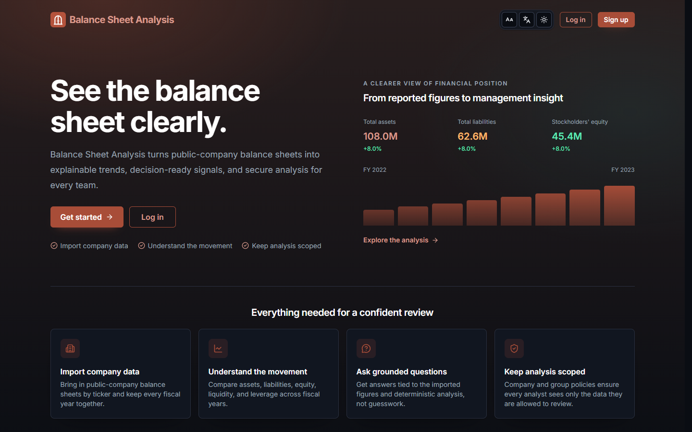
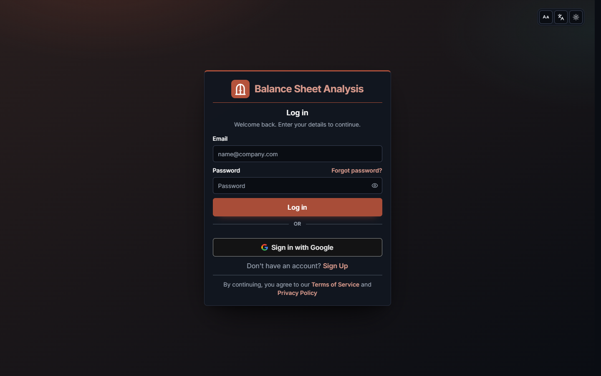
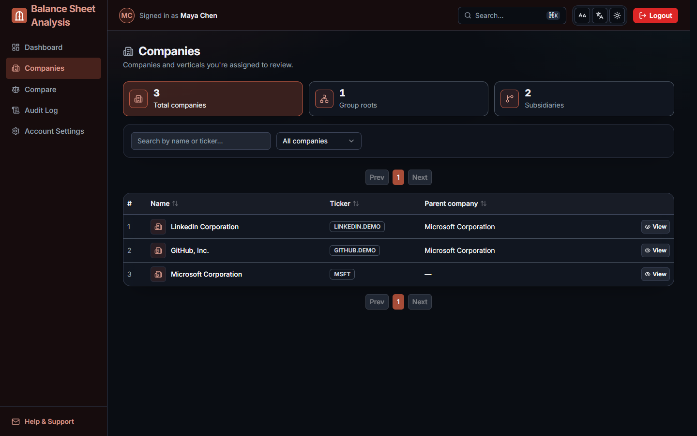
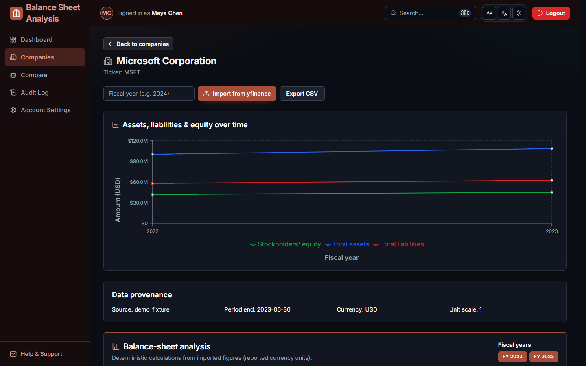
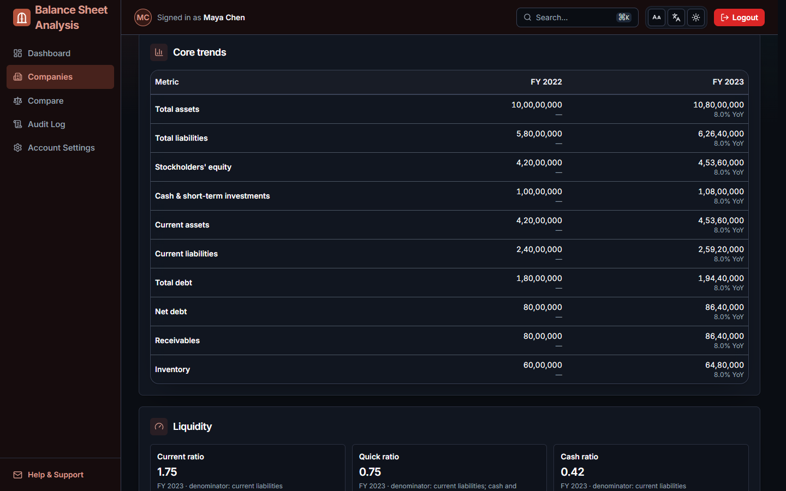
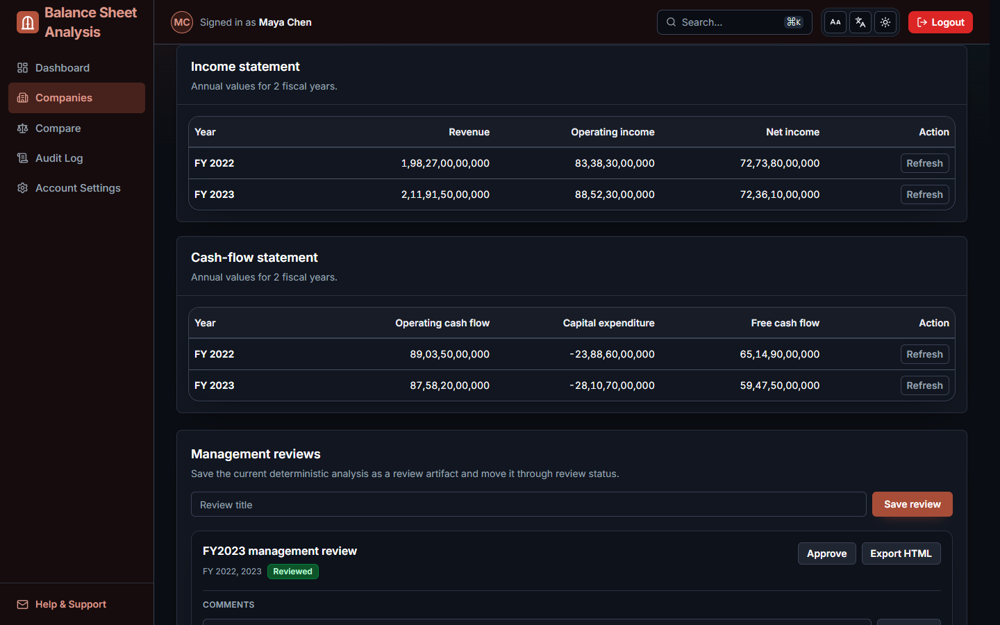
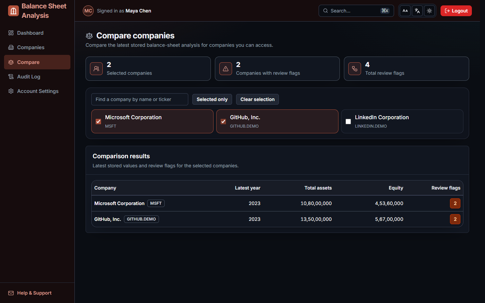
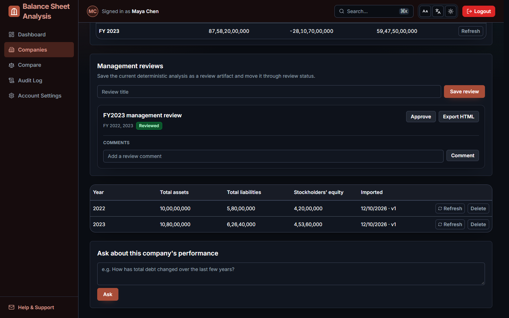
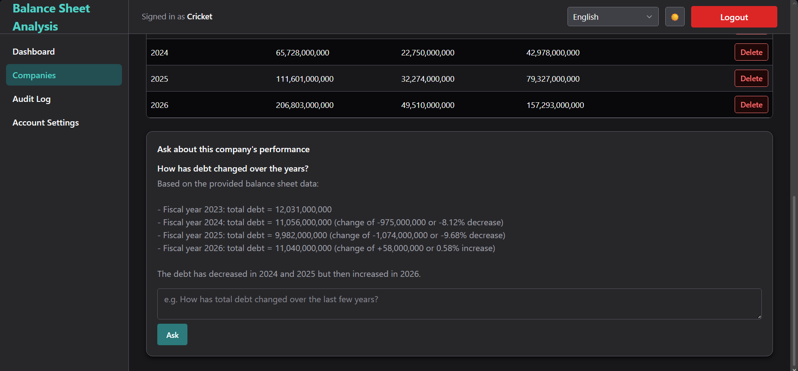
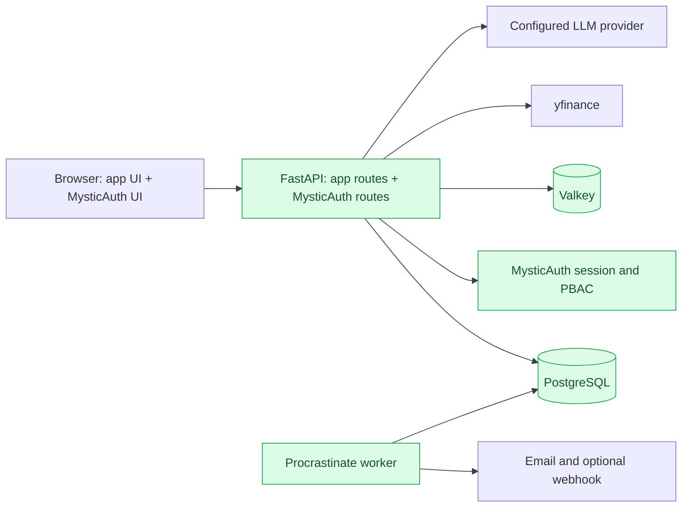

# Balance Sheet Analysis

---


---

## Overview

A company financial analysis tool for importing balance sheets, reviewing
annual and quarterly trends, comparing companies, saving management reviews,
and asking questions grounded in stored financial data. Company access is
checked on the server with MysticAuth's Policy-Based Access Control (PBAC).

MysticAuth provides authentication, session management, and the PBAC engine.
This application owns its financial models, company-scoped policies, analysis
services, and product UI. The ownership split is reflected in the code and
documentation trees.

---

## Screenshots

### Product overview



<details>
<summary>See all 9 application screenshots</summary>

---

#### Sign in



---

#### Companies



---

#### Company detail



---

#### Balance sheet analysis



---

#### Financial statements



---

#### Company comparison



---

#### Management review



---

#### Company chat



</details>

---

## Architecture



---

## Product features

- Import and refresh balance sheets with source provenance and version history.
- Compare explicitly selected companies and analyze trends, liquidity,
  leverage, warnings, and optional currency normalization.
- Import curated income and cash-flow data, including quarterly and TTM
  analysis.
- Save review snapshots with comments, assignments, sign-offs, and HTML export.
- Ask company-scoped LLM questions using selected stored financial data.
- Configure durable analysis alerts and email or optional webhook delivery.
- Support English, Hindi, Marathi, and Gujarati for the app's own UI.

All company data and company-scoped API operations are authorized server-side.
See [Company Access Control](docs/app/access-control/README.md).

---

## Stack

- **Backend:** FastAPI, SQLAlchemy async, Alembic, and Python.
- **Frontend:** React, TypeScript, Vite, Tailwind CSS, Chakra UI, and Recharts.
- **Data:** PostgreSQL, Valkey, yfinance, and a configurable OpenAI-compatible
  LLM provider.
- **Background jobs:** Procrastinate with PostgreSQL-backed task storage.
- **Authentication and authorization:** MysticAuth, vendored in
  `backend/mystic_auth/` and `frontend/src/mystic_auth/`.
- **Deployment:** Docker Compose development, local-prod tunnel modes, and
  server-hosted production mode.

---

## Quickstart

Use Docker for the full development stack:

```bash
./scripts/mystic_auth/env-tools/setup-env/setup-env.sh
./scripts/mystic_auth/docker/dev/dev-up.sh
```

The helper creates the split local environment files when needed, starts both
Compose layers, waits for healthy services, and tails application logs. Then
follow [Application Quickstart](docs/app/quickstart.md) to create the
MysticAuth system superuser, seed app policies, and grant a user's company
access.

---

## Documentation

- [App documentation](docs/app/README.md): app architecture, setup, API,
  features, access control, and scripts.
- [Application flow diagrams](docs/app/flows/README.md): Mermaid diagrams for
  company access, imports, analysis, chat, reviews, and alert delivery.
- [MysticAuth documentation](docs/mystic_auth/README.md): authentication,
  PBAC, infrastructure, testing, CI, and deployment.
- [MysticAuth template usage](docs/mystic_auth/template-usage/overview.md):
  downstream ownership and upstream synchronization.
- [Contributor guide](CONTRIBUTING.md): local checks and contribution workflow.
- [Security policy](SECURITY.md): vulnerability reporting.

---

## Testing

CI runs the backend, frontend, integration, security, browser, and deployment
checks. The backend cumulative coverage gate is 90%; frontend coverage gates
remain 90%. See [MysticAuth Testing](docs/mystic_auth/testing/overview.md) for
the full pipeline and commands.

---

## License

MIT. See [LICENSE](LICENSE).

---
