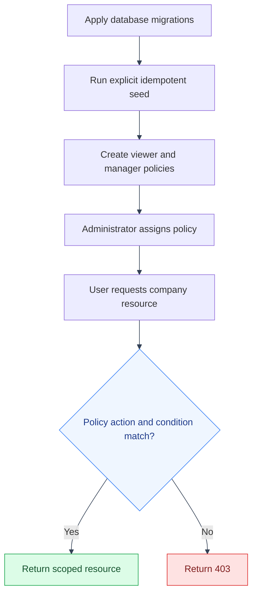

# Baseline RBAC-Shaped Policies
---
Every scoped policy in [Overview](overview.md) needs a real `company_id`/`group_root_id` to
condition on: fine once you have real companies, not something a fresh
install has on day one. Run `backend/app/seed/seed_base_policies.py`
explicitly after `alembic upgrade head`; the current Compose stack does not
run it automatically. It creates two
**unconditioned** policies instead, RBAC-shaped, per
[unconditioned-policy quickstart](../../mystic_auth/authorization/unconditioned-policy-quickstart.md) ("a
policy with no conditions at all is already RBAC"), the same shape as
mystic_auth's own `self_service`/`user_administration`/`system_superuser`:

| Policy                  | Actions granted                                                                             | Applies to        |
|--------------------------|-----------------------------------------------------------------------------------------------|---------------------|
| `role_company_viewer`    | `company:read`, `balance_sheet:read`, `llm:chat`                                              | every company        |
| `role_company_manager`   | + `company:create`, `company:update`, `company:delete`, `balance_sheet:import`, `balance_sheet:delete` | every company        |

These exist so a real, freshly-onboarded user can be granted usable access
immediately: assign one from the `/policies`/`/users` UI, no conditions
JSON to write. The company/group-scoped policies described in
[Overview](overview.md) (CEO of one company, group executive, ...) are what
you reach for once "every company" is too broad for a given persona: same
mechanism, just with a `conditions` block added, not a different one to learn.

---

## See also

---

- [Access-control index](README.md)
- [App documentation](../README.md)
