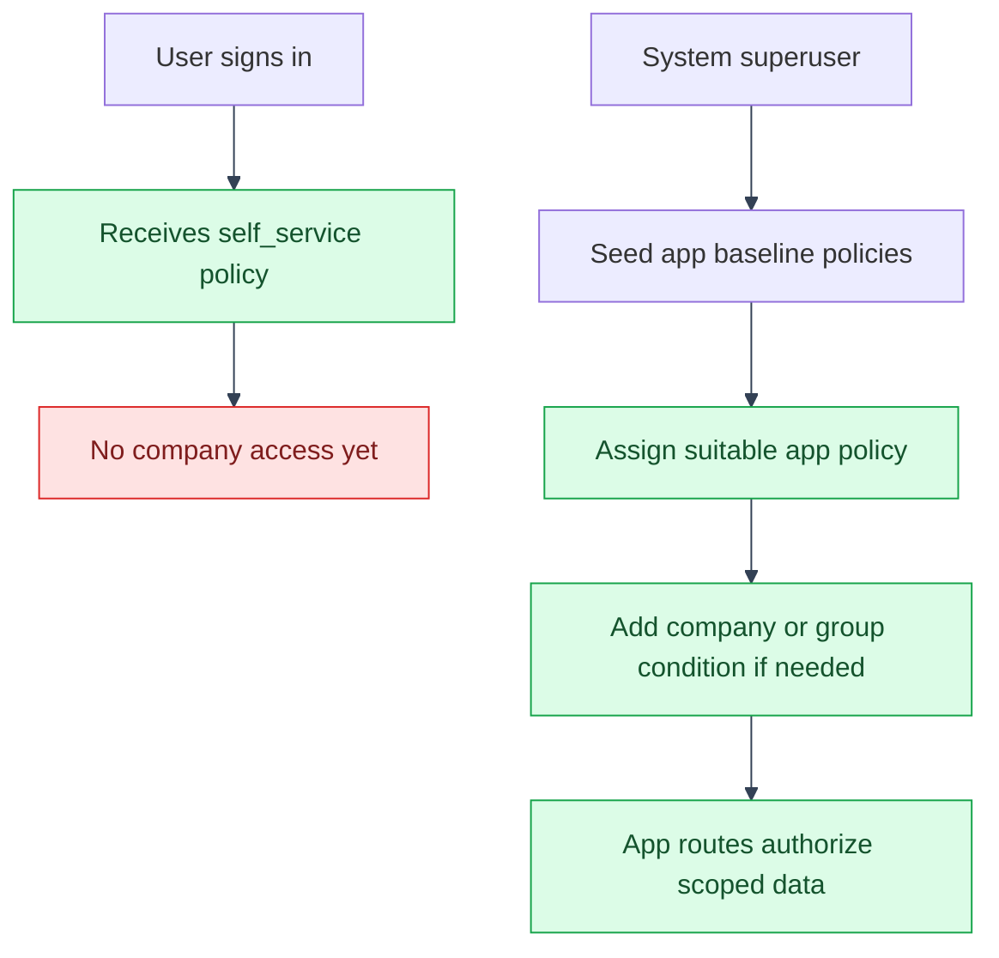

# Onboarding a Real User
---

---

## Why a fresh Google login sees no company data

---

Every new account, whether via signup or Google OAuth, is auto-assigned exactly
one mystic_auth baseline policy, `self_service` (`users:read_own`,
`users:update_own` only; see `backend/mystic_auth/auth/oauth2/oauth2_service.py`
and the seed migration `b7d3a1c9e4f2_add_pbac_policies.py`). It grants nothing
app-specific, so on first login:

- The "Companies" sidebar link (`App.tsx`'s `EXTRA_NAV_ITEMS`, gated by its
  own `permission: APP_PERMISSIONS.COMPANY_READ`) doesn't render.
- `/companies` itself 403s (`ProtectedRoute permission={APP_PERMISSIONS.COMPANY_READ}`)
  even if visited directly by URL.

The user sees only mystic_auth's own stock dashboard: this is PBAC working
as intended, not a missing feature or a role check to fix. **Access is never
granted by promoting a role** (see [Roles Are Metadata](roles-are-metadata.md));
it's granted by creating and assigning a policy, the same administrative
action for every persona:

1. Log in once as the reserved system superuser (created via
   `docker compose -f docker/mystic_auth/compose/docker-compose.dev.yml \
   -f docker/app/compose/docker-compose.dev.yml \
   --env-file env/mystic_auth/.env.dev --env-file env/app/.env.dev \
   exec backend python -m mystic_auth.scripts.create_system_user`;
   see the root `README.md`).
2. On mystic_auth's own (unmodified) `/policies` and `/users` pages, either
   assign one of the two ready-made [baseline policies](baseline-policies.md)
   (`role_company_viewer`/`role_company_manager`) for immediate, unscoped
   access, or create a policy shaped like one of the rows in
   [Overview](overview.md)'s table (e.g. `{"resource_attributes":
   {"group_root_id": 1}}` granting `company:read`, `balance_sheet:read`,
   `llm:chat`) for one company/group specifically. Either way: assign it to
   the target user's account, no code change, no deploy.
3. `backend/app/seed/seed_demo_data.py` seeds this exact policy shape, but
   only for its own fixed demo accounts (analyst/CEO/group-exec, prompted
   for a shared password at run time); it's a reference for the
   condition/action shape to replicate, not something that runs against a
   real OAuth-created account automatically.
---

## Alternative: auto-granting a policy on signup

---

mystic_auth's `DEFAULT_APP_POLICIES` setting (root `.env`, empty by default)
auto-assigns a comma-separated list of policy names to every user alongside
`self_service` the moment they verify, skipping the manual per-user
assignment step above entirely. Not enabled here: this app currently grants
company access per-user/per-group deliberately (see
[Overview](overview.md)'s table), which a blanket default would bypass. If a
future policy shape here is meant to apply to every user unconditionally
(e.g. a truly org-wide `role_company_viewer`), set `DEFAULT_APP_POLICIES` in
`.env` instead of assigning it by hand each time. See
`backend/mystic_auth/core/settings.py`'s `DEFAULT_APP_POLICIES` and
`authorization/policies/default_policies.py` for the mechanics.

---

## See also

---

- [Access-control index](README.md)
- [App documentation](../README.md)
