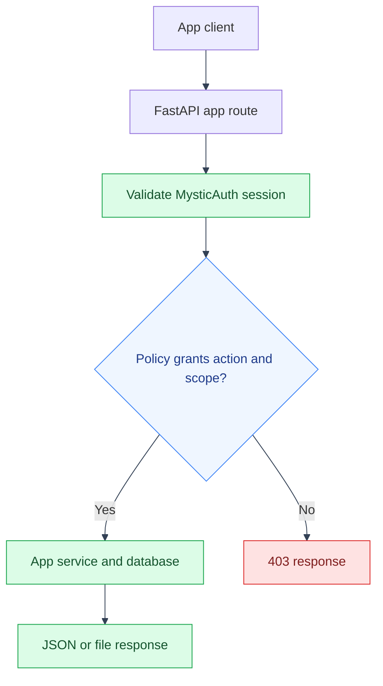

# App API Reference
---
mystic-auth's own endpoints (`/auth/*`, `/users/*`, `/authorization/*`,
`/audit/*`, `/health/*`) are documented under
[`../mystic_auth/api/`](../mystic_auth/api/), unchanged by this project.
Everything below is defined in `backend/app/`.

All endpoints require an authenticated session (the `access_token` cookie
mystic-auth's login sets) and enforce PBAC per
[Access Control](access-control/overview.md); a company/balance-sheet/LLM request
outside the caller's scope returns `403`, not a filtered or empty `200`.

---

## Companies

---

| Method | Path                     | Action checked   | Notes                                                                 |
|--------|--------------------------|-------------------|------------------------------------------------------------------------|
| GET    | `/companies/`             | `company:read`     | Every company the caller's policies grant, paginated (`limit`/`offset`, `X-Total-Count` header), with `search`/`hierarchy`/`sort_by`/`sort_dir` query params; see [Enforcement](access-control/enforcement.md)'s list-endpoint scoping. |
| GET    | `/companies/stats`        | `company:read`     | `{total, group_roots, subsidiaries}` counts over the same scope as the list above, not a system-wide total. Registered ahead of `/{id}` so `"stats"` isn't parsed as a company id. |
| POST   | `/companies/`              | `company:create`   | `{name, ticker, parent_company_id?}`. Omit `parent_company_id` for a group root; `group_root_id` is computed automatically. |
| GET    | `/companies/lookup/{ticker}` | `company:create` | Best-effort exact-match ticker -> company name autofill from yfinance for the "add company" form; `name` is `null` (not 404) for an unknown ticker. Rate-limited per-account. |
| GET    | `/companies/search/{query}` | `company:create` | Autocomplete-style ticker/name search from yfinance for the same form. Rate-limited per-account. |
| GET    | `/companies/{id}`          | `company:read`     | 404 if the company doesn't exist, 403 if it exists but is outside the caller's scope. |
| PATCH  | `/companies/{id}`          | `company:update`   | Partial update (only fields sent are changed). Same fetch-then-authorize-against-the-row pattern as GET/DELETE. |
| DELETE | `/companies/{id}`          | `company:delete`   | Cascades to delete every balance sheet on file for it (`BalanceSheet.company_id` is `ON DELETE CASCADE`). 400 if it has subsidiary companies (`parent_company_id` is `ON DELETE SET NULL`, not `CASCADE`, so a subsidiary's `group_root_id` would otherwise point at a company that no longer exists); delete or reassign those first. |

Routes: `backend/app/api/company_routes/company_routes.py`.
---

## Balance sheets

---

| Method | Path                                | Action checked         | Notes                                                                 |
|--------|--------------------------------------|--------------------------|--------------------------------------------------------------------------|
| GET    | `/balance-sheets/company/{company_id}` | `balance_sheet:read`      | Every fiscal year on file for one company.                              |
| GET    | `/balance-sheets/{company_id}/{year}`  | `balance_sheet:read`      | One fiscal year.                                                        |
| POST   | `/balance-sheets/{company_id}/{year}`  | `balance_sheet:import`    | Fetches from yfinance using the company's `ticker` and persists it. Add `?refresh=true` to replace the current period while retaining a restatement snapshot. 400 if a row already exists without refresh, or yfinance has no data; 502 if the yfinance fetch itself fails (network error, Yahoo API error, timeout; see [Features](features.md#yfinance-needs-a-browser-impersonating-timeout-bounded-session)). Rate-limited (per-IP and per-account); each call is a real outbound yfinance request. |
| DELETE | `/balance-sheets/{company_id}/{year}`  | `balance_sheet:delete`    | 404 if no such row.                                                     |
| GET    | `/balance-sheets/company/{company_id}/export.csv` | `balance_sheet:read` | Downloads the scoped balance-sheet periods and provenance as CSV. |

Response fields include `imported_at`, `period_end_date`, `period_type`,
`source_provider`, `source_url`, `currency_code`, `unit_scale`, `version`, and
the import source-field list, plus ~68 nullable float fields (one per yfinance
balance-sheet line item; see
`backend/app/balance_sheets/balance_sheet_model.py`).

Routes: `backend/app/api/balance_sheet_routes/balance_sheet_routes.py`.
---

## LLM chat

---

| Method | Path         | Action checked | Notes |
|--------|--------------|------------------|-------|
| POST   | `/llm/chat`   | `llm:chat`        | `{company_id, years?, question}` -> `{answer}`. Context includes deterministic balance-sheet analysis and curated statement fields with source tokens. The prompt requests citations; returned citations are not programmatically validated. Questions are bounded and calls are rate-limited. |
| POST   | `/llm/feedback?company_id={id}` | `llm:chat` | Stores only helpful/not-helpful feedback and an optional comment after the same company-scope check. |
| GET | `/llm/status` | authenticated user | Performs a token-free provider `/models` health probe and returns provider/model, configuration, reachability, latency, and a bounded error code; never returns the key. |
| GET | `/llm/usage` | authenticated user | Returns the caller's recorded usage totals and configured daily character budget without prompt contents. |
| GET | `/llm/usage/admin` | `llm:usage_read_all` | Returns the last-24-hour aggregate usage by user, including failed request counts, without prompt contents. |
| GET | `/llm/operations/admin` | `llm:usage_read_all` | Returns bounded last-24-hour provider probe counts, reachability, failures, average latency, and the latest error code. |

Routes: `backend/app/api/llm_routes/llm_routes.py`.
---

## Balance-sheet analysis

---

| Method | Path | Action checked | Notes |
|--------|------|----------------|-------|
| GET | `/balance-sheet-analysis/company/{company_id}` | `balance_sheet:read` | Returns deterministic trends, liquidity/leverage metrics, common-size composition, source values, warnings, thresholds, data-quality issues, and optional currency normalization. Optional repeated `years` and `target_currency` query parameters narrow or normalize the analysis. |
| GET | `/balance-sheet-analysis/compare` | `balance_sheet:read` | Compares up to 20 explicitly selected companies. Repeat `company_ids` and optionally `years`; every selected company is authorized server-side before any analysis is returned. |
| GET | `/balance-sheet-analysis/benchmark` | `balance_sheet:read` | Benchmarks a validated trend metric across 2-20 explicitly selected, authorized companies. Returns values and percentile context; provide `target_currency` when values need conversion before comparison. |
| GET/PATCH | `/balance-sheet-analysis/company/{company_id}/settings` | GET: `balance_sheet:read`; PATCH: `balance_sheet:import` | Reads or updates company-scoped warning thresholds, including covenant checks for liquidity, leverage, equity, and long-term-debt concentration, plus target currency and display scale. Updates are recorded in history. |
| GET | `/balance-sheet-analysis/company/{company_id}/settings/history` | `balance_sheet:read` | Lists threshold and normalization setting changes with the actor and timestamp. |
| GET/POST | `/balance-sheet-analysis/company/{company_id}/currency-rates` | GET: `balance_sheet:read`; POST: `balance_sheet:import` | Lists or records dated conversion rates with an explicit source and optional source URL. No rate is inferred when source currency is unknown. |
| GET | `/balance-sheet-analysis/company/{company_id}/alerts` | `balance_sheet:read` | Lists durable alerts generated from the deterministic analysis. Resolved alerts can be included with `include_resolved=true`. |
| PATCH | `/balance-sheet-analysis/alerts/{alert_id}` | `balance_sheet:read` | Acknowledges or resolves an alert after re-checking the alert's company scope. |
| GET/PATCH | `/balance-sheet-analysis/company/{company_id}/notification-policy` | GET: `balance_sheet:read`; PATCH: `balance_sheet:import` | Configures company alert recipients, minimum severity, and delayed escalation recipients. Users can disable alert email through their own preference. |
| GET | `/balance-sheet-analysis/company/{company_id}/notification-deliveries` | `balance_sheet:read` | Lists alert email and optional deployment-webhook deliveries with their status and Procrastinate job IDs. |
| GET/PATCH | `/balance-sheet-analysis/notifications/preferences` | authenticated user | Reads or changes the signed-in user's alert email preference. |

Analysis values use `reported currency units` unless `target_currency` is
requested and a dated, company-scoped conversion rate exists. The response
includes the rate source and any periods that could not be normalized. Ratios
are unavailable when their denominator is missing or non-positive. Review
thresholds are explicit in the response and are not accounting, investment,
tax, or legal conclusions.
---

## Income and cash-flow statements

---

| Method | Path | Action checked | Notes |
|--------|------|----------------|-------|
| GET | `/financial-statements/company/{company_id}` | `balance_sheet:read` | Lists curated annual or quarterly income and cash-flow metrics. Optional `statement_type` and `period_type` filters narrow the response. |
| GET | `/financial-statements/company/{company_id}/analysis` | `balance_sheet:read` | Returns deterministic annual trends, TTM aggregates when four quarters exist, margins, cash conversion, free-cash-flow reconciliation, and warnings. |
| GET | `/financial-statements/{company_id}/{statement_type}/{year}` | `balance_sheet:read` | Returns one statement period with provider provenance. |
| POST | `/financial-statements/{company_id}/{statement_type}/{year}` | `balance_sheet:import` | Imports curated metrics from yfinance. Use `period_type=quarterly&period_number=1..4` for a quarter and `refresh=true` to replace an existing period. |

Statement imports are rate-limited per IP and per account. The first
implementation exposes revenue, gross profit, operating income,
EBITDA, pretax income, net income, operating cash flow, capital expenditure,
free cash flow, investing cash flow, financing cash flow, and ending cash
position. Missing provider fields remain null and are shown as unavailable.

The worker refreshes the latest stored periods daily. It never invents a period
that is not already stored, and each provider attempt remains auditable.
---

## Saved reviews

---

| Method | Path | Action checked | Notes |
|--------|------|----------------|-------|
| GET | `/reviews/company/{company_id}` | `balance_sheet:read` | Lists saved deterministic review artifacts for a scoped company. |
| POST | `/reviews/company/{company_id}` | `balance_sheet:read` | Saves the selected balance-sheet analysis as a draft review artifact. Requires at least one stored period. |
| GET | `/reviews/{report_id}` | `balance_sheet:read` | Returns one saved report after re-authorizing against its company. |
| PATCH | `/reviews/{report_id}` | `balance_sheet:read` | Moves a report through `draft`, `reviewed`, `approved`, or `superseded`. |
| GET | `/reviews/{report_id}/comments` | `balance_sheet:read` | Lists comments after re-authorizing against the report's company. |
| POST | `/reviews/{report_id}/comments` | `balance_sheet:read` | Adds a scoped review comment attributed to the authenticated account. |
| GET/POST | `/reviews/{report_id}/assignments` | `balance_sheet:read` | Lists or records scoped assignment history. |
| GET/POST | `/reviews/{report_id}/signoffs` | `balance_sheet:read` | Lists or records sign-off history and updates the report status. |
| GET | `/reviews/{report_id}/export.html` | `balance_sheet:read` | Downloads a printable HTML snapshot with periods, trends, warnings, and notes. |

Review reports are snapshots of deterministic analysis, not mutable live
queries. The stored years and analysis payload show exactly what the reviewer
saw when the artifact was created.
---

## Error codes

---

404s from this app's own routes (`get_or_404`, re-exported by
`backend/app/sdk.py`) carry a machine-readable `code` alongside the English
`detail`. Current codes include `COMPANY_NOT_FOUND`,
`BALANCE_SHEET_NOT_FOUND`, `FINANCIAL_STATEMENT_NOT_FOUND`,
`REVIEW_REPORT_NOT_FOUND`, and `ALERT_NOT_FOUND`. These app-specific codes are
translated into all four supported languages: see
[Translations](architecture/translations.md) for how. Their messages live in
the app-owned `frontend/src/app/translations/languages/*/errors.json` files,
not MysticAuth's upstream-owned bundles.
---

## Rate limiting

---

Company ticker lookup/search, balance-sheet imports, financial-statement
imports, and LLM chat reuse MysticAuth's
Valkey-backed `rate_limiter_service` (the same one gating `/auth/login`,
`/auth/signup`, etc.; see
[`../mystic_auth/security/hardening.md`](../mystic_auth/security/hardening.md)),
with the limiter configuration applied by each route. A caller over the
limit gets `429`. The ticker and financial import routes also make external
yfinance requests; chat calls the configured LLM provider. Other app routes
do not use this application-level rate limiter.
---

## Action vocabulary

---

See `backend/app/access/permissions.py` (Python) /
`frontend/src/app/access/permissions.ts` (TypeScript) for the exact string
constants. The action strings used by routes are `company:read`,
`company:create`, `company:update`, `company:delete`, `balance_sheet:read`,
`balance_sheet:import`, `balance_sheet:delete`, `llm:chat`, and
`llm:usage_read_all`. The analysis, statement, and review routes use the
balance-sheet read/import actions because those resources share company scope
and policy assignments.

---

## See also

---

- [App documentation](README.md)
- [Application flows](flows/README.md)
