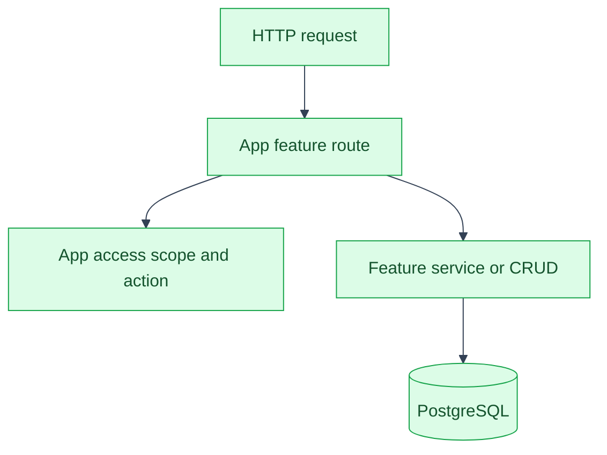

# Architecture: Conventions
---
See [Overview](overview.md) for the directory tree these rules produce.
---

## Keep API clients separate from feature state and views

---

MysticAuth keeps raw Axios functions in `frontend/src/mystic_auth/api/` and
feature pages, hooks, and dialogs in separate folders. This app follows the
same split: `frontend/src/app/api/` contains the company, balance-sheet,
analysis, statement, LLM, and review clients. React Query hooks and pages stay
under `companies/`, `balance-sheets/`, `financial-statements/`, `llm/`, and
`reviews/`.
---

## Keep app permissions separate from MysticAuth authorization

---

`frontend/src/app/access/permissions.ts` and `backend/app/access/permissions.py`
define this product's action strings, including `company:read`,
`balance_sheet:import`, `llm:chat`, and `llm:usage_read_all`. MysticAuth's
`authorization/` folders implement the shared enforcement mechanism (`IfCan`,
`ProtectedRoute`, `useAuthorization`, and the authorization service). The app
uses that mechanism through its SDK and does not duplicate it.
---

## Keep routes thin and domain code outside the HTTP layer

---

MysticAuth separates domain logic from HTTP routes. The app follows the same
pattern: `companies/`, `balance_sheets/`, `financial_statements/`, `reviews/`,
and `llm/` contain models, schemas, CRUD, and services; request handlers live
under `app/api/<feature>_routes/<feature>_routes.py`.

`app_sdk.py` re-exports selected MysticAuth internals needed by app domain
modules, including the shared declarative `Base`. It must not import app
routers or domain modules: that would create a cycle through the models.
`main.py` mounts app routers directly from their route modules.
---

## See also

---

- [Architecture index](README.md)
- [App documentation](../README.md)
- [SDK and Extension Points](sdk-and-extension-points.md)
