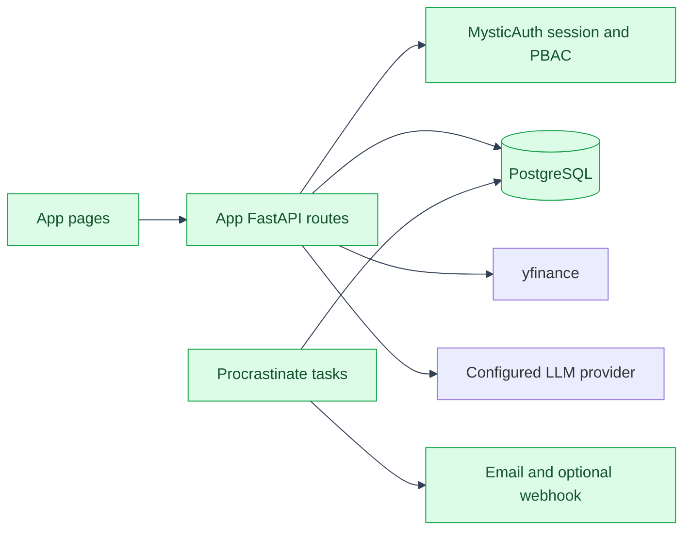

# Architecture: The `app/` vs `mystic_auth/` Split, in Practice
---
The app owns financial data and product workflows. MysticAuth supplies the
shared authentication, authorization, session, audit, and UI foundations. The
ownership boundary is described in
[`template-usage/ownership-split.md`](../../mystic_auth/template-usage/ownership-split.md).
---

## Backend

---

```text
backend/
  mystic_auth/             upstream template internals
  app/
    main.py                mounts shared and app routers; starts app workers
    sdk.py                 upstream public re-export surface; do not edit
    app_sdk.py             app-owned bridge for MysticAuth exports absent from sdk.py
    access/                app PBAC action names and company scope helpers
    api/                   HTTP routes, grouped by feature
      company_routes/      company CRUD and yfinance lookup/search
      balance_sheet_routes/ balance-sheet import, read, export, and delete
      analysis_routes/     trends, comparison, benchmarks, settings, rates, alerts
      financial_statement_routes/ annual/quarterly statements and analysis
      llm_routes/          grounded chat, feedback, provider status, usage, operations
      review_routes/       saved review snapshots, comments, assignments, sign-offs
    companies/             company model, schemas, and CRUD
    balance_sheets/        balance-sheet models, analysis, alerts, settings, currencies
    financial_statements/  statement models, curated fields, and deterministic analysis
    reviews/                saved review models and schemas
    llm/                    provider configuration, prompt service, and usage models
    procrastinate_tasks/    scheduled financial refresh and alert delivery tasks
    core/                   app-owned settings
    seed/                   baseline app policies and optional demo dataset
  alembic/                  shared migration history for both code trees
```

`backend/alembic/env.py` imports both model sets into one metadata collection.
Migrations from MysticAuth and the app therefore share one linear history.
---

## Frontend

---

```text
frontend/src/
  mystic_auth/              upstream auth flows, PBAC, shared layout and UI
  app/
    App.tsx                 shared route composition and app navigation
    sdk.ts                  upstream public re-export surface; do not edit
    app_sdk.ts              app-owned bridge for missing public SDK exports
    access/                 app permission strings used by route and UI checks
    api/                    app Axios clients only
    companies/              company list, detail, comparison, and query hooks
    balance-sheets/         balance-sheet charts, analysis, and query hooks
    financial-statements/   annual and quarterly statement views and query hooks
    reviews/                 review snapshots, comments, and status actions
    llm/                     company chat and LLM operations page
    landing_page/            public product overview and its translations
    legal/                   app terms and privacy pages
    status_pages/            app-specific not-authorized and not-found pages
    translations/            app namespaces registered with shared i18next
```

Feature components and clients use the MysticAuth public SDK for capabilities
it exports. `app_sdk.ts` centralizes only capabilities that are not on that
public surface. See [SDK and Extension Points](sdk-and-extension-points.md).
---

## Runtime flow

---



All company-scoped routes authorize against the server-side company/group
scope. Provider imports and LLM calls are initiated by backend services; the
browser does not receive provider credentials. Scheduled refreshes and alert
delivery run through the app's Procrastinate tasks.
---

## See also

---

- [Conventions](conventions.md)
- [SDK and Extension Points](sdk-and-extension-points.md)
- [Translations](translations.md)
- [Features](../features.md)
- [Application flows](../flows/README.md)
- [Syncing with upstream](../syncing.md)
