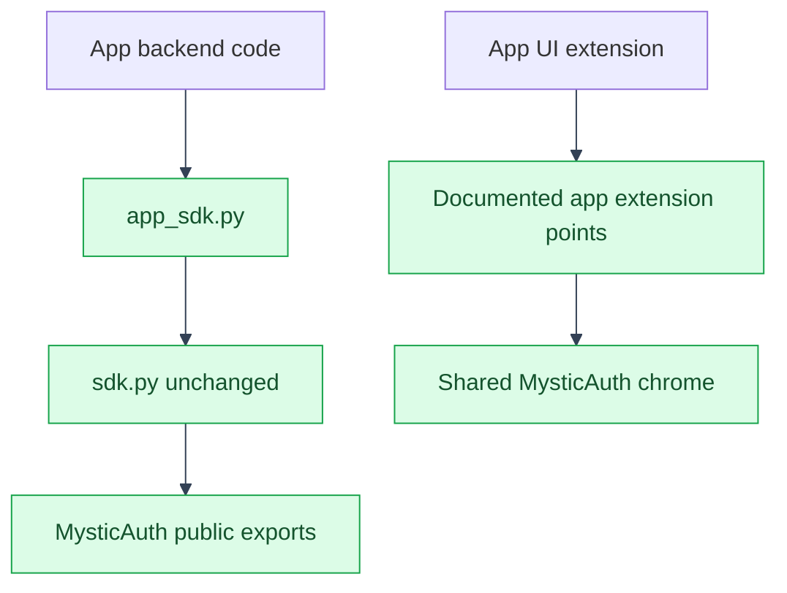

# Architecture: SDK and Extension Points
---
See [Overview](overview.md) for the directory tree these rules produce.

---

## Why `sdk.py`/`app_sdk.py` split the way they do

---

Per [`template-usage/overview.md`](../../mystic_auth/template-usage/overview.md): `sdk.py` re-exports
template pieces, kept exactly as shipped so upstream updates apply cleanly.
Anything this app needs from `mystic_auth/` that isn't already in `sdk.py`
(here: `policy_repository`, for `access/scope.py`'s list-filtering logic;
`Base`, so this app's models share one declarative base/migration history
with mystic_auth's; and `rate_limiter_service`, reused to rate-limit the LLM
chat and balance-sheet import endpoints) is re-exported from **`app_sdk.py`**
instead, not added to `sdk.py`, so `sdk.py` never diverges from upstream
at all, and every addition this app needed lives in the one file that's
unambiguously ours. `app_sdk.py` also re-exports `password_service` and
`user_crud`, needed only by `app/seed/seed_demo_data.py` to create demo
users through mystic_auth's own signup path rather than inserting rows by
hand.
---

## Keep app feature code on the public SDK surface

---

The template guidance says to import MysticAuth capabilities from its public
SDK, not its internal paths. Backend feature code uses `sdk.py` for published
exports and `app_sdk.py` for the additional exports this app needs:
`policy_repository`, the shared `Base`, `rate_limiter_service`, `password_service`,
`user_crud`, and the existing email task. The app-specific bridge does not
re-export this app's own routes or models.

Frontend feature code imports from `sdk.ts` when MysticAuth publishes the
capability there. `app_sdk.ts` currently bridges `DashboardPage` and these
exports not present on the public surface: the card `StatTile`, `FilterPanel`,
`SearchInput`, `FilterChips`, `FilterChip`, `StyledSelectOption`, `SortState`,
and `SortDirection`. It does not forward public exports such as
`TableActionButton`, `StyledSelect`, `Pagination`, shared hooks, or the display
`StatTile` from `sdk.ts`. Recheck the bridge after upstream syncs and remove
each bridge once MysticAuth publishes the same capability.

`App.tsx` composes the app routes with MysticAuth's shared layout and auth
routes; it is a documented shared extension point. Keep app feature logic in
the downstream `app/` tree and follow the ownership rules when changing shared
composition files.
---

## Nav gap: `extraNavItems`, not a dashboard wrapper

---

`frontend/src/mystic_auth/layout/Sidebar.tsx` reads its link list from
`mystic_auth/layout/navItems.ts`, a template internal, not an extension
point. Adding "Companies" there would mean editing `mystic_auth/`, which
breaks clean upstream merges. Instead, `App.tsx` (this app's own file) passes
`AppLayout` an `extraNavItems` prop (`{ label: "Companies", to: "/companies",
order: 15, ... }`), the actual extension point `template-usage/overview.md`
documents for exactly this. `order: 15` places it between the built-in
Dashboard (`10`) and Users (`20`) entries.

An earlier version of this app routed `/dashboard` through an
`AppDashboardPage` wrapper instead, whose only job was rendering mystic_auth's
own `DashboardPage` plus a "View your companies" button, a workaround from
before `extraNavItems` was adopted for the sidebar link above. With Companies
already permanently in the sidebar, that button was a redundant second entry
point, so the wrapper was removed: `/dashboard` now renders mystic_auth's own
`DashboardPage` directly (re-exported from `app_sdk.ts`, since `sdk.ts` itself
is never-edit and doesn't cover it). Every route is still independently
protected by the reused (unedited) `ProtectedRoute`/PBAC check regardless of
how a user navigates to it.

---

## See also

---

- [Architecture index](README.md)
- [App documentation](../README.md)
