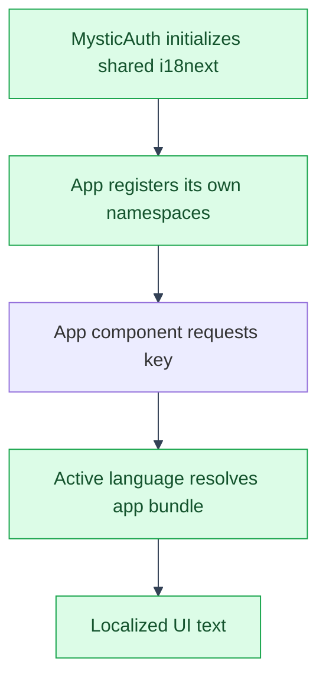

# Translations
---
This app's own UI text (companies, financial statements, analysis, reviews,
alerts, legal pages, and LLM operations) and its backend error codes
(`COMPANY_NOT_FOUND`, `BALANCE_SHEET_NOT_FOUND`,
`FINANCIAL_STATEMENT_NOT_FOUND`, `REVIEW_REPORT_NOT_FOUND`, and
`ALERT_NOT_FOUND`) are translated into the same four languages
mystic_auth ships (English, Hindi, Marathi, Gujarati), following mystic_auth's own translation
architecture (see [mystic_auth Translations](../../mystic_auth/translations/overview/README.md)) without
editing a single upstream-owned file to do it.

---


---

## Why this isn't just "add keys to mystic_auth's files"

---

`frontend/src/mystic_auth/translations/translations.ts` is upstream-owned: every sync applies
cleanly there because nothing of this app's ever touches it. Hand-editing it to add
app namespaces or this app's own error codes into its `errors.json` files would
create exactly the kind of local edit to an upstream-owned file that
`scripts/mystic_auth/upstream-sync/sync-upstream.sh` is built to never have to reconcile. So this app's
translations live entirely under `frontend/src/app/translations/`, registered into the *same*
running i18next instance mystic_auth already initializes, rather than replacing or duplicating it.
---

## How the registration works

---

`i18next`'s default export (the `i18next` npm package) is a shared, module-level singleton: every
file that does `import i18next from "i18next"` gets the exact same configured object, regardless of
which file happened to call `.init()` on it first. mystic_auth's `translations.ts` calls
`.use(initReactI18next).init(...)` once, at module-load time (triggered eagerly via
`store/languageStore.ts`, imported early in `frontend/src/mystic_auth`'s own bootstrap path).

`frontend/src/app/translations/translations.ts` imports that same `i18next` singleton and calls
[`i18next.addResourceBundle(lng, ns, resources, deep, overwrite)`](https://www.i18next.com/how-to/add-or-load-translations)
for every language/namespace pair this app defines, instead of calling `.init()` a second time:

```ts
import i18next from "i18next";
import enCompanies from "./languages/en/companies.json";
// ...

i18next.addResourceBundle("en", "companies", { ...enCompanies }, true, false);
```

- **New namespaces** (`companies`, `balance_sheets`, `analysis`, `llm`): `addResourceBundle` creates them the
  first time they're registered, exactly as if they'd been in mystic_auth's own `init()` call.
- **The `errors` namespace**: already exists (mystic_auth registered it). `deep=true` merges this
  app-specific error keys (`COMPANY_NOT_FOUND`, `BALANCE_SHEET_NOT_FOUND`,
  `FINANCIAL_STATEMENT_NOT_FOUND`, `REVIEW_REPORT_NOT_FOUND`, and
  `ALERT_NOT_FOUND`) into the existing bundle
  instead of replacing it; `overwrite=false` means this app's keys can never clobber an upstream
  one even if a name collided. For `errors`, the app first detaches the existing MysticAuth
  bundle before merging because i18next mutates merge inputs; this keeps the upstream JSON source
  objects unchanged for parity checks. `apiError.ts`'s `extractApiErrorMessage()` looks up `errors:<code>`
  in that single namespace regardless of which side (upstream or this app) registered the code, so
  this is the only way this app's own `AppError(code=...)` call sites (see
  [App API Reference](../api.md#error-codes)) get a translated message at all.

`frontend/src/app/main.tsx` imports `./translations/translations.ts` right after the mystic_auth
`languageStore.ts` import, so registration always happens before the first render - see that
file's own comment for the exact ordering reasoning.
---

## Where the resources live

---

```
frontend/src/app/translations/
├── translations.ts                     # registers app feature namespaces and error keys
├── registerLandingTranslations.ts      # registers the landing page bundles
├── registerLegalTranslations.ts        # registers terms and privacy bundles
├── registerStatusPagesTranslations.ts  # registers app status-page bundles
└── languages/
    └── {en,hi,mr,gu}/{companies,balance_sheets,analysis,llm,errors}.json
```

One namespace per feature folder under `frontend/src/app/`, same convention mystic_auth uses for
its own `frontend/src/mystic_auth/` folders. Components read them the same way any mystic_auth
component does:

```tsx
import { useTranslation } from "react-i18next";

const { t } = useTranslation("companies");
// ...
<Text>{t("pageTitle")}</Text>
```

`CompanyDetailPage.tsx` is the one component that needs two namespaces at once (it renders both
company-level chrome and the balance-sheet table/import/delete flow for that company), so it calls
`useTranslation(["companies", "balance_sheets"])` and prefixes every key explicitly
(`t("balance_sheets:deleteBalanceSheetTitle")`) to stay unambiguous about which file owns each
string - the same explicit-prefix style mystic_auth's own `PolicyStatsCard.tsx` uses when a
component's default namespace and the key it needs don't match.
---

## Tests

---

`frontend/src/mystic_auth/__tests__/setup.ts`'s own translations import is upstream-owned, so it
was never a place to add this app's registration. `tests/frontend/app/setup.ts` is this app's
counterpart - it imports `frontend/src/app/translations/translations.ts` the same way, and is
listed alongside the upstream one in `frontend/vitest.config.ts`'s `setupFiles` array (a
shared-tier file this app is expected to extend, see
[Template Usage Overview](../../mystic_auth/template-usage/overview.md#the-app--mystic_auth-split)).
Without it, any test rendering a component that calls `useTranslation` for an
app feature namespace would see raw translation keys instead of real text.

The four app error bundles keep the same key set so errors resolve consistently
in English, Hindi, Marathi, and Gujarati.
---

## Adding a new language

---

This app doesn't define the supported language list or locale formatting;
those remain MysticAuth concerns. Once MysticAuth supports a language code,
add matching feature and error bundles under
`frontend/src/app/translations/languages/<code>/`, add the landing-page bundle
under `frontend/src/app/landing_page/translations/`, and update each app
registration module for that language. Review legal and status-page content
under the documented MysticAuth translation-content exception before enabling
the language.

---

## See also

---

- [Architecture index](README.md)
- [App documentation](../README.md)
