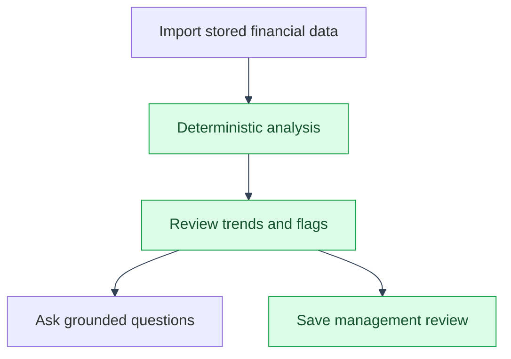

# Feature Implementation Notes
---
See [Architecture](architecture/README.md) for the overall `app/`/`mystic_auth/` structure this fits into.

---

## LLM chat scope

---

`backend/app/api/llm_routes/llm_routes.py` builds the company and year scoped
context from deterministic balance-sheet analysis and stored annual or
quarterly income and cash-flow statements. The balance-sheet context contains
curated metrics and source values; the statement context contains curated
fields with stable `[source:type:FYyear:field]` tokens. The prompt tells the
provider to use only that context and cite numeric claims with the supplied
tokens. The app does not validate citations in the returned answer, so this
prompt instruction is not a guarantee that every answer is correctly cited.
---

## Deterministic balance-sheet analysis

---

`backend/app/balance_sheets/analysis_service.py` calculates core trends,
liquidity, leverage, solvency, common-size composition, and neutral review flags
from the stored balance-sheet rows. Missing fields and non-positive denominators
produce an explicit unavailable state. The configurable review thresholds are
20% for material change, 50% for a large reported movement, and two consecutive
falling cash intervals, and a 20 percentage-point growth gap for receivables,
inventory, or debt versus total assets. These are screening triggers for management review, not
professional accounting opinions. The analysis endpoint and the LLM chat both
use this same calculated output, including source fields and warning evidence.

The provider status endpoint performs a token-free health probe against the
configured OpenAI-compatible `/models` endpoint and records bounded probe
history. An administrator granted the separate `llm:usage_read_all` action can
view last-24-hour usage totals by user and provider operations telemetry,
including reachability, failure count, and average latency; prompts and API
keys are never returned.

Company ticker lookup/search, balance-sheet imports, financial-statement
imports, and LLM chat use MysticAuth's rate limiter. The provider-backed
imports are rate-limited because they make external yfinance requests; chat
is rate-limited because each request uses the configured LLM provider.
---

## yfinance needs a browser-impersonating, timeout-bounded session

---

`backend/app/balance_sheets/balance_sheet_crud.py` builds a
`curl_cffi.requests.Session(impersonate="chrome", timeout=15)` and passes it
to `yf.Ticker(ticker, session=...)` instead of using yfinance's default
session. Two non-obvious constraints require this:

- **No default timeout.** yfinance has no built-in request timeout:
  a hung/slow Yahoo response would tie up an `asyncio.to_thread` worker
  indefinitely, since this is the one blocking network call in the app run
  off the event loop this way.
- **Plain `requests`/`urllib3` sessions are rejected outright.**
  `yfinance/data.py` raises `YFDataException` unless the
  session is specifically a `curl_cffi` session, since Yahoo's API blocks the
  TLS/HTTP fingerprint of a plain Python HTTP client, so yfinance switched to
  `curl_cffi` with Chrome impersonation (`impersonate="chrome"`) to get past
  that. This remains true across the 0.2.x to 1.x line, re-verified against
  yfinance 1.5.2). A custom `requests.Session` subclass (the obvious way to
  inject a timeout) fails with `"Yahoo API requires curl_cffi session not
  <class ...>"`, found by
  actually running the import flow against a real ticker, not from any
  yfinance error message alone.

Any fetch failure here (timeout, this rejection, a genuine network error,
or a malformed Yahoo response) is caught and re-raised as `YFinanceFetchError`
(a `RuntimeError` subclass), which `balance_sheet_routes.py` maps to `502`,
kept distinct from the `ValueError`/`400` "no data for this ticker/year"
case (see the balance-sheets table in [API Reference](api.md)).
---

## Balance-sheet provenance and refreshes

---

Each imported period records its provider, source URL, import time, fiscal
period end date when Yahoo supplies one, period type, currency when available,
unit scale, source row labels, quality status, and version. Yahoo does not
always expose currency or unit metadata, so those fields remain explicitly
unknown rather than being presented as USD by assumption.

Import attempts are retained with success, no-data, rejected, or failed
statuses. A normal duplicate import remains rejected. Passing
`?refresh=true` snapshots the current values into `balance_sheet_snapshots`,
then replaces the current period and increments its version. This keeps the
current view simple while preserving evidence when Yahoo restates or changes
a reported period.

The same `curl_cffi` session pattern (same helper constant,
`_YFINANCE_TIMEOUT_SECONDS`) is duplicated in
`backend/app/companies/company_crud.py`'s `lookup_company_name_by_ticker`/
`search_company_tickers`, the two yfinance-backed autofill helpers behind the
`GET /companies/lookup/{ticker}` and `GET /companies/search/{query}` routes
(see [API Reference](api.md)): any yfinance call anywhere in this app needs
the same session, not just the balance-sheet import path.

The company detail view exposes the latest import provenance, supports CSV
export, and lets an analyst with import permission refresh a stored period.
The comparison view sends explicitly selected company IDs to the server, so
the browser never filters unauthorized financial rows locally.

Income-statement and cash-flow imports use a downstream feature module
with explicit curated fields rather than storing an opaque provider response.
They use the same company-scoped authorization, rate limiting, provenance,
refresh snapshots, and provider-failure handling as balance sheets. Values are
still reported provider units until currency and scale normalization is added;
unknown metadata is displayed as unknown. Annual and quarterly periods have
explicit period keys, and deterministic statement analysis reports margins,
cash conversion, free-cash-flow margin, reconciliation warnings, and TTM
aggregates once four complete quarters are available. Company-scoped dated
currency rates can normalize balance-sheet values with the source and any
unavailable periods shown explicitly.

Saved management reviews persist deterministic analysis for selected years
as a draft artifact. A scoped user can move the report through `draft`,
`reviewed`, `approved`, and `superseded` states, so a management discussion
can refer to a stable snapshot even after new provider data is imported.
Review comments are attached to the saved artifact and inherit the same
company-scope check. Reports also support assignment history, sign-off history,
and an HTML export. Peer benchmark quality remains dependent on selecting
trusted comparable entities and sources. Warning thresholds
are company-configurable and triggered warnings are persisted as alerts that
can be acknowledged or resolved. Covenant screening covers current ratio,
quick ratio, cash ratio, debt-to-assets, net-debt-to-equity, equity ratio, and
long-term-debt concentration. These are configurable review triggers, not
contractual accounting conclusions. A downstream Procrastinate task refreshes
each company's latest stored balance-sheet and statement periods daily; failed
periods remain visible through import-attempt history and the worker retries a
batch with provider failures. Companies can configure alert recipients,
minimum severity, delayed escalation recipients, and delivery visibility;
users can opt out of alert email without changing the company's policy.
Deployments may additionally set the app-owned `ANALYSIS_ALERT_WEBHOOK_URL` to
send alert payloads to one external system. The URL stays in deployment
configuration and is never returned by the API; webhook delivery status is
recorded beside email delivery status.

The benchmark endpoint compares a validated balance-sheet metric across an
explicitly selected set of authorized companies and returns percentile context.
---

## Company hierarchy vs. the old `Vertical` model

---

The pre-migration repo (see git history prior to this migration) had an
unused `Vertical` model alongside `Company.parent_company_id`, which already
models the same hierarchy. Dropped in this migration: a vertical (e.g. GitHub,
Inc. under Microsoft Corporation) is just an ordinary child `Company` row.

---

## See also

---

- [App documentation](README.md)
- [Application flows](flows/README.md)
