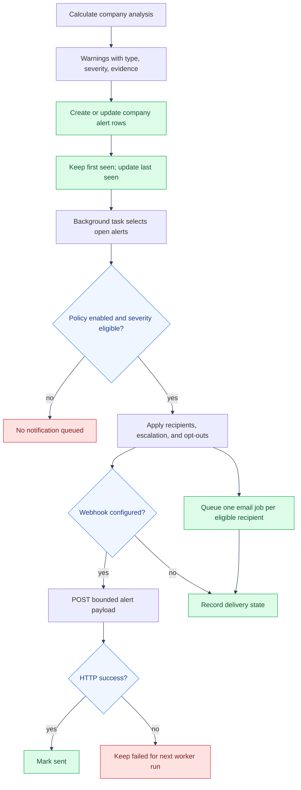

# Analysis Alerts and Delivery Flow
---

The analysis service emits warning evidence. The app reconciles those warnings
with durable company alerts, and a background worker queues eligible email and
optional webhook deliveries.
---

## Alert and notification flow

---

---

## Settings and privacy

---

Company administrators configure recipients, minimum severity, and escalation
delay. Each user can opt out of alert email without changing company policy.
Webhook URLs remain in deployment configuration and are not exposed through
the API or saved in delivery rows. Delivery history retains channel, recipient
label, status, timestamps, and email job ID where applicable.
---

## Code references

---

- `backend/app/balance_sheets/analysis_settings.py`
- `backend/app/balance_sheets/analysis_notifications.py`
- `backend/app/procrastinate_tasks/analysis_notification_tasks.py`
- `backend/app/api/analysis_routes/analysis_routes.py`
- `frontend/src/app/balance-sheets/BalanceSheetAnalysisPanel.tsx`
---

## See also

---

- [App API reference](../api.md#balance-sheet-analysis)
- [Feature implementation notes](../features.md#deterministic-balance-sheet-analysis)
