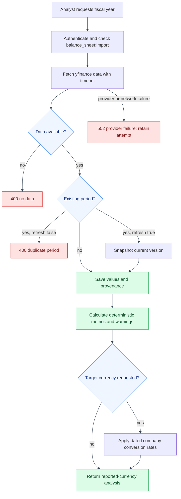

# Balance-Sheet Import and Analysis Flow
---

This flow covers a company's annual balance-sheet import, refresh history,
scoped analysis, and optional currency normalization.
---

## Import and analysis

---

---

## Data retained

---

Each period stores provider provenance, source fields, period end date,
currency and scale when known, quality status, and a version. Refresh saves the
previous values into `balance_sheet_snapshots` before replacing the current
period. Failed, empty, duplicate, and successful import attempts remain
available as operational history.

Analysis uses the persisted rows. Missing values and non-positive ratio
denominators remain explicitly unavailable. Conversion uses dated,
company-owned rates; the response identifies the rate source and periods that
could not be converted.
---

## Code references

---

- `backend/app/api/balance_sheet_routes/balance_sheet_routes.py`
- `backend/app/balance_sheets/balance_sheet_crud.py`
- `backend/app/api/analysis_routes/analysis_routes.py`
- `backend/app/balance_sheets/analysis_service.py`
- `backend/app/balance_sheets/currency_service.py`
- `frontend/src/app/companies/CompanyDetailPage.tsx`
---

## See also

---

- [App API reference](../api.md#balance-sheets)
- [Feature implementation notes](../features.md#balance-sheet-provenance-and-refreshes)
- [Financial statements and TTM](financial-statements-and-ttm.md)
