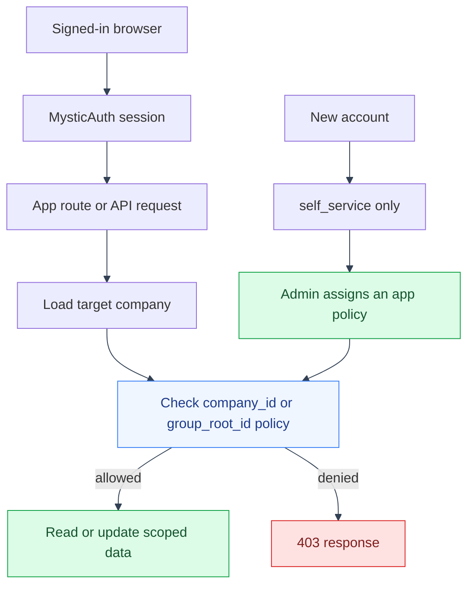

# Company Access and Onboarding Flow
---

This page follows a user from initial account access to a company-scoped
request. MysticAuth owns authentication and the PBAC engine; the app owns
company scope and its permission vocabulary.
---

## Request flow

---

---

## Ownership and code

---

| Step | File | Role |
|---|---|---|
| Authenticate the request | `backend/mystic_auth/` | Validates the session and exposes the current user. |
| Define app actions | `backend/app/access/permissions.py` | Names company, balance-sheet, and LLM actions. |
| Build company scope | `backend/app/access/scope.py` | Filters list queries or checks one resource against company/group policy attributes. |
| Enforce a route | `backend/app/api/` | Requires the action before returning protected app data. |
| Render protected UI | `frontend/src/app/App.tsx` and shared MysticAuth guards | Hides unavailable navigation and blocks direct route access. |

A new account receives MysticAuth's `self_service` policy only. An administrator
must assign an app policy before the user can see company data. A role value is
display metadata and does not grant access.
---

## See also

---

- [Access-control overview](../access-control/overview.md)
- [Enforcement paths](../access-control/enforcement.md)
- [Onboarding a real user](../access-control/onboarding.md)
- [Roles are metadata](../access-control/roles-are-metadata.md)
