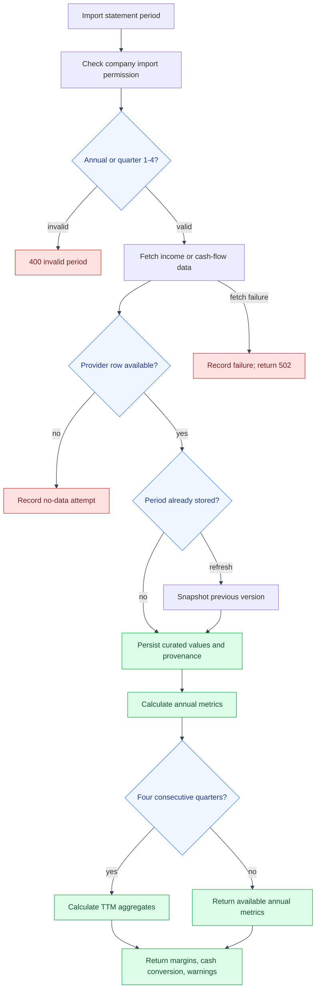

# Financial Statements and TTM Flow
---

Income and cash-flow statements use a curated set of provider fields and an
explicit annual or quarterly period key. This page shows how an import becomes
deterministic annual and trailing-twelve-month metrics.
---

## Import and calculation

---

---

## Period rules

---

- Annual periods use `period_type=annual` and `period_number=0`.
- Quarterly periods use `period_type=quarterly` and a quarter number from 1 to 4.
- TTM values are produced only when four complete consecutive quarters are
  available. The analysis does not fill gaps or infer missing quarters.
- Refresh preserves the previous row in a snapshot and increments its version.
---

## Code references

---

- `backend/app/api/financial_statement_routes/financial_statement_routes.py`
- `backend/app/financial_statements/financial_statement_crud.py`
- `backend/app/financial_statements/statement_analysis.py`
- `backend/app/procrastinate_tasks/financial_refresh_tasks.py`
- `frontend/src/app/financial-statements/FinancialStatementsPanel.tsx`
---

## See also

---

- [App API reference](../api.md#income-and-cash-flow-statements)
- [Balance-sheet import and analysis](balance-sheet-import-and-analysis.md)
- [Feature implementation notes](../features.md)
