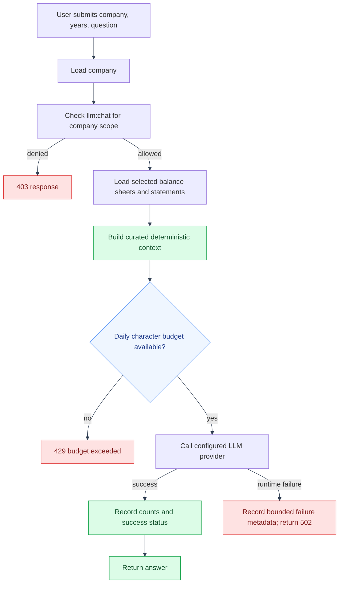

# Grounded LLM Chat Flow
---

Chat is scoped to one company and uses that company's persisted financial
records to build context. The user question and generated answer are not stored
in the usage table.
---

## Request flow

---

---

## Privacy and limits

---

The application sends selected financial context and the question to the
configured provider. The local usage record stores character counts, provider,
model, status, and a bounded error code; it does not store prompt text or API
keys. Requests are rate limited and checked against the per-account daily
character budget before the provider call.
---

## Code references

---

- `backend/app/api/llm_routes/llm_routes.py`
- `backend/app/llm/llm_service.py`
- `backend/app/llm/llm_usage.py`
- `frontend/src/app/llm/LlmChatWidget.tsx`
---

## See also

---

- [App API reference](../api.md#llm-chat)
- [App setup](../setup.md#environment-variables-this-app-adds)
- [Analysis alerts and delivery](analysis-alerts-and-delivery.md)
