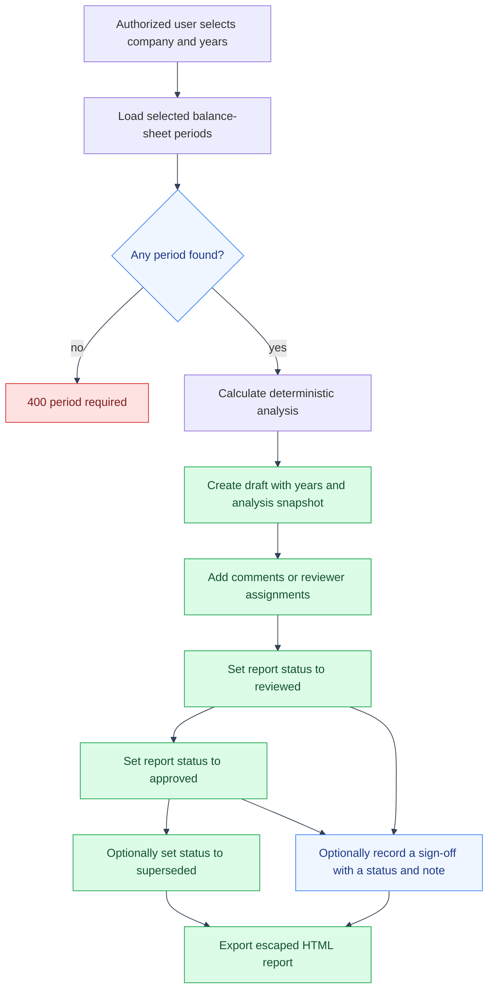

# Saved Management Review Flow
---

A saved review is a point-in-time snapshot of deterministic analysis and the
fiscal years included. Later imports do not rewrite the saved analysis.
---

## Review lifecycle

---

---

## Scope and retained state

---

Every report, comment, assignment, and sign-off is authorized through the
report's company. The accepted report statuses are `draft`, `reviewed`,
`approved`, and `superseded`; status changes are not restricted to a fixed
transition graph. Sign-offs are separate history records and also set the
report status to the submitted value. HTML export escapes report content and
carries the screening disclaimer. The snapshot stores deterministic values
and the years used; it does not claim to be accounting, tax, legal, or
investment advice.
---

## Code references

---

- `backend/app/api/review_routes/review_routes.py`
- `backend/app/reviews/review_model.py`
- `backend/app/reviews/review_schema.py`
- `frontend/src/app/reviews/ReviewReportPanel.tsx`
---

## See also

---

- [App API reference](../api.md#saved-reviews)
- [Balance-sheet import and analysis](balance-sheet-import-and-analysis.md)
