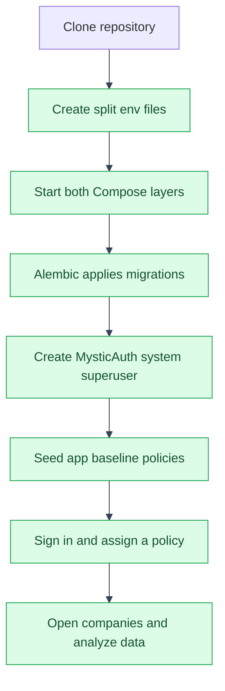

# Application Quickstart
---

This quickstart starts the development stack and grants a new account access to
the app. MysticAuth handles the shared authentication setup; this page covers
the app-specific additions.
---

## First-run flow

---


---

## Start the development stack

---

1. Clone the repository and enter its root directory.
2. Create the paired MysticAuth and app development environment files:

   ```bash
   ./scripts/mystic_auth/env-tools/setup-env/setup-env.sh
   ```

   The setup tool generates secret values. Do not copy real values into
   `.example` files or commit local `.env` files.
3. Start the stack using the platform helper:

   ```bash
   ./scripts/mystic_auth/docker/dev/dev-up.sh
   ```

   On PowerShell use `scripts\mystic_auth\docker\dev\dev-up.ps1`; on Command
   Prompt use `scripts\mystic_auth\docker\dev\dev-up.cmd`. The helper waits
   for service health before tailing the main application logs.
4. Open the frontend at `http://localhost:5173` and the FastAPI docs at
   `http://localhost:8000/docs`.

The stack uses both `docker/mystic_auth/compose/docker-compose.dev.yml` and
`docker/app/compose/docker-compose.dev.yml`, plus the matching
`env/mystic_auth/.env.dev` and `env/app/.env.dev` files. Migrations run from the
shared Alembic history automatically.
---

## Create an administrator and grant app access

---

Create MysticAuth's reserved system superuser from the repository root:

```bash
docker compose \
  -f docker/mystic_auth/compose/docker-compose.dev.yml \
  -f docker/app/compose/docker-compose.dev.yml \
  --env-file env/mystic_auth/.env.dev \
  --env-file env/app/.env.dev \
  exec -it backend python -m mystic_auth.scripts.create_system_user
```

Then seed this app's two ready-to-assign baseline policies:

```bash
docker compose \
  -f docker/mystic_auth/compose/docker-compose.dev.yml \
  -f docker/app/compose/docker-compose.dev.yml \
  --env-file env/mystic_auth/.env.dev \
  --env-file env/app/.env.dev \
  exec backend python -m app.seed.seed_base_policies
```

Sign in with the system account, open `/policies` or `/users`, and assign
`role_company_viewer` or `role_company_manager` to the account that needs access.
These starter policies grant unconditioned access to app resources. For
company-specific access, create a policy with `company_id` or `group_root_id`
conditions instead; see [Access Control](access-control/README.md).
---

## Optional demo dataset

---

To explore scoped access with three illustrative companies, run:

```bash
docker compose \
  -f docker/mystic_auth/compose/docker-compose.dev.yml \
  -f docker/app/compose/docker-compose.dev.yml \
  --env-file env/mystic_auth/.env.dev \
  --env-file env/app/.env.dev \
  exec backend python -m app.seed.seed_demo_data
```

The command prompts for a shared password and creates `maya.chen@demo.example`,
`leo.martins@demo.example`, and `jordan.okafor@demo.example` with illustrative
balance-sheet data plus annual income and cash-flow statement fixtures for
FY2022 and FY2023. This is disposable sample data, not live market data.
---

## Next steps

---

- Set an LLM provider key to enable chat; see [Setup](setup.md#environment-variables-this-app-adds).
- Follow [Onboarding a real user](access-control/onboarding.md) for scoped company access.
- See [App API reference](api.md) and [Application flows](flows/README.md).
- For MysticAuth credentials, Google OAuth, email, and system-account details,
  use its [template quickstart](../mystic_auth/template-usage/quickstart.md).
---

## See also

---

- [Setup](setup.md)
- [App documentation index](README.md)
- [MysticAuth quickstart](../mystic_auth/template-usage/quickstart.md)
