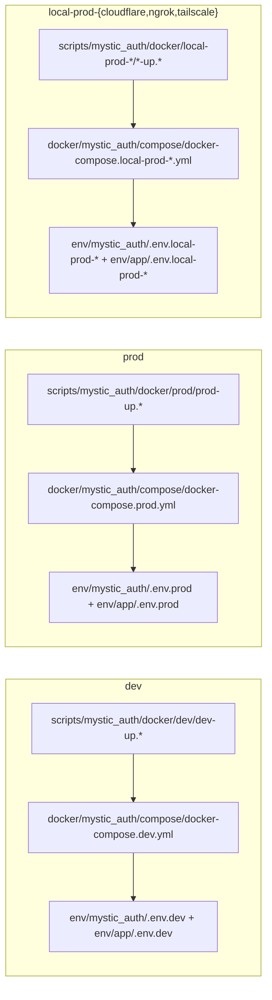

# Operational Scripts
---
Everything under [`scripts/mystic_auth/`](../../scripts/mystic_auth/) is a
standalone operational helper from the template. None of it runs
automatically as part of the app itself. `docker compose up` covers
migrations, while this app's baseline-policy seed is an explicit command
(`python -m app.seed.seed_base_policies`), so these scripts handle the
workflows Compose does not. This app's own scripts, if any, live in
[`scripts/app/`](../../scripts/app/) instead, so upstream syncs never touch
them.

| Script | What it does | Why you'd run it |
|---|---|---|
| `docker/dev/dev-up.sh` / `.ps1` / `.cmd` | Starts the full dev stack using the upstream compose file plus `docker/app/compose/docker-compose.dev.yml`, waits for every service to report healthy, then tails only `backend`/`frontend`/`procrastinate_worker` logs. | The day-to-day startup command. It also bootstraps the split `env/mystic_auth/.env.dev` + `env/app/.env.dev` files when needed. |
| `docker/prod/prod-up.sh` / `.ps1` / `.cmd`, `docker/local-prod-{cloudflare,ngrok,tailscale}/*-up.{sh,ps1,cmd}` | Same idea as `dev-up`, for the production-shaped compose files under `docker/mystic_auth/compose/`. | Standing up a self-hosted deployment (server-hosted `prod`, or a tunnel-based `local-prod-*` mode). See [Compose Modes](../mystic_auth/docker/compose-modes.md). |
| `docker/dev/backend-exec.sh` / `.ps1` / `.cmd` | Thin wrapper around `docker compose exec` for the dev stack's backend container that bakes in the Windows/Git Bash and native-Linux workarounds (`MSYS_NO_PATHCONV=1`, `--user root`, `-w /repo`) documented in [Docker Overview](../mystic_auth/docker/overview.md#running-a-one-off-command-inside-a-container). Safe to use unconditionally on every platform. | Running any one-off command inside the backend container (`pytest`, `alembic heads`, a shell) without having to remember or reapply those workarounds by hand. |
| `env-tools/setup-env/setup-env.sh`, `env-tools/check-env/`, `env-tools/rotate-secrets/`, `env-tools/copy-env-values/`, `env-tools/set-env-field/` | Bootstraps every `env/mystic_auth/.env.*` and `env/app/.env.*` file (plus `frontend/.env`) with generated secrets, then validates, rotates, or carries values forward on later syncs. | First-time setup and safe environment maintenance. App-only values belong in the `env/app` half. |
| `upstream-sync/sync-upstream.sh` | Pulls in updates from the upstream mystic-auth template repo: a whole-tree squash merge on the first run, an incremental three-way diff/apply on every run after that (tracked via `.mystic-auth-sync-state`). Refuses to commit if a file silently failed to apply, or if the sync left `backend/alembic/versions/` with two heads. | On-demand only; nothing runs this automatically. Use it when mystic-auth ships a new release you want (a security fix, a new feature) and you want it merged into `backend/mystic_auth/`, `frontend/src/mystic_auth/`, `docs/mystic_auth/`, etc. without touching this app's own code. See [Syncing Upstream Template Updates](../mystic_auth/template-usage/syncing-upstream/README.md). |
| `upstream-sync/check-alembic-heads.sh` | Statically parses `backend/alembic/versions/*.py` for more than one migration with no children (a branched history), no python/alembic install or running database needed. Called automatically by `sync-upstream.sh`. | Run standalone any time you want to confirm the migration history is still linear, e.g. after hand-editing a migration's `down_revision`. |
| `upstream-sync/test-sync-upstream.sh` | Regression test for `sync-upstream.sh`, run against throwaway fake "upstream"/"consumer" repos under a temp directory. Never touches this repo's own history. | Run manually after editing `sync-upstream.sh` itself, to confirm both sync strategies (first-sync squash, incremental diff/apply) and their conflict/safety-check handling still work before trusting it against this real repo. |
| `db/db_backup.sh` | Dumps the `postgres` Compose service's app database and its Bugsink database to timestamped `.dump` files under `backups/`. Reads the matching `env/mystic_auth/.env.<mode>` and `env/app/.env.<mode>` configuration. | Before a migration, an upgrade, or anything else you'd want a rollback point for. |
| `db/db_restore.sh` | Restores a `.dump` (or legacy `.sql`) backup from `db_backup.sh` into the `postgres` Compose service. Destructive because it overwrites rows and tables defined by the dump, so it asks for confirmation unless `-y`/`--yes` is passed. | Recovering from a bad migration or bad data, or standing up a fresh environment from a known-good backup. |
| `load-test/load_test.py` | Throughput/capacity load test against a running stack's `/health/`, `/auth/login`, and `/auth/me`-style scenarios (`--scenario`, `--concurrency`, `--requests`, `--base-url`); reports latency percentiles and error rate. Not a pytest file and not run in CI. | By hand against a local-prod/staging stack before a release, to see how many req/s it sustains before latency or the error rate degrades; `/auth/*` scenarios need `--email`/`--password` for an existing verified account, and stay under the per-IP `MAX_REQUESTS_PER_WINDOW` budget or they measure the rate limiter instead of server capacity. |

Every path in this table is relative to `scripts/mystic_auth/`.
---

## Compose file / env file / helper script pairing

---

Each deployment mode has a MysticAuth compose file plus an app override, a
matching pair of env files, and one `*-up` helper, all named consistently:

`db_backup.sh`/`db_restore.sh` derive the matching env file from whichever
compose file you pass them (see the table above), rather than needing it
spelled out separately.

---

## See also

---

- [App documentation](README.md)
- [Application flows](flows/README.md)
