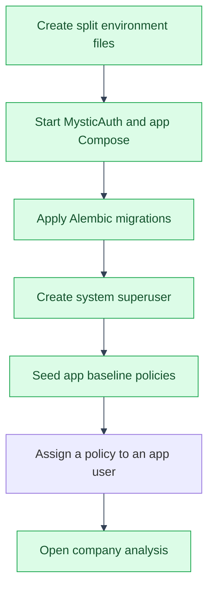

# Setup
---
Follow mystic-auth's own setup first:
[`../mystic_auth/README.md`](../mystic_auth/README.md) and
[`template-usage/overview.md`](../mystic_auth/template-usage/overview.md), to get
`docker compose up` running with a system superuser created. Everything
below is additional, specific to this app.


---

## Environment variables this app adds

---

Not part of `mystic_auth.core.settings.Settings` (that's a template
internal). Compose loads these values from `env/app/.env.dev` (or the
matching `env/app/.env.<mode>` for a prod/local-prod deployment), while
`backend/app/main.py` loads the development file pair for local runs. The
LLM config then reads the resulting process environment:

| Variable        | Required | Default                                              |
|------------------|----------|--------------------------------------------------------|
| `LLM_API_KEY` (or `GROQ_API_KEY`) | Yes (for LLM chat) | none: chat requests fail with 502 until set |
| `LLM_PROVIDER`   | No       | `groq` |
| `LLM_API_URL` (or `GROQ_API_URL`) | No | `https://api.groq.com/openai/v1/chat/completions` |
| `LLM_MODEL` (or `GROQ_MODEL`) | No | `llama-3.1-8b-instant` |
| `LLM_MAX_TOKENS` | No | `800` (bounded to 128-4000) |
| `LLM_DAILY_CHAR_BUDGET` | No | `500000` input/output characters per account per rolling day |
| `ANALYSIS_ALERT_WEBHOOK_URL` | No | empty: alert webhook delivery disabled; when set, open alerts are POSTed by the worker |

The app example files carry this fork's shared identity defaults and are the
place for app-specific additions. Add further values to the real
`env/app/.env.dev` (and the matching mode file when deploying elsewhere); keep
app-only values out of `env/mystic_auth/.env.*`.

The frontend inherits MysticAuth's shipped default brand color, `#b5533c`,
when no custom color is configured. If `setup-env` asks for a brand color and
you want the default appearance, enter `#b5533c`.
---

## Migrations

---

This app's tables for companies, balance sheets and snapshots, analysis
settings and alerts, currency rates, financial statements and snapshots,
review reports and their activity, and LLM usage/feedback/provider probes
share MysticAuth's Alembic history. One `alembic upgrade head` applies both:
run it with `docker compose run --rm alembic`, or start the `alembic` service
automatically with `docker compose up`. See `backend/alembic/env.py` for how
both sets of models feed into the same `target_metadata`.
---

## Baseline policies

---

After migrations, run the app-owned seed explicitly:

```bash
docker compose \
  -f docker/mystic_auth/compose/docker-compose.dev.yml \
  -f docker/app/compose/docker-compose.dev.yml \
  --env-file env/mystic_auth/.env.dev \
  --env-file env/app/.env.dev \
  exec backend python -m app.seed.seed_base_policies
```

This creates the two ready-to-assign RBAC-shaped policies,
`role_company_viewer` and `role_company_manager` (see
`backend/app/seed/seed_base_policies.py` and
[Baseline Policies](access-control/baseline-policies.md)). The seed is
idempotent. After creating the system superuser, assign one of these policies
to a user from the `/policies` UI; there is no conditions JSON to write.
---

## Seeding demo data (optional)

---

To additionally explore the full company-hierarchy *scoping* model (not
just the two unconditioned roles above), seed the Microsoft-group example dataset
(three companies, two fiscal years of illustrative balance-sheet data, and
three users: an analyst, a company CEO, and a group executive, each with the
company-scoped policy [Access Control](access-control/overview.md) describes):

```bash
docker compose \
  -f docker/mystic_auth/compose/docker-compose.dev.yml \
  -f docker/app/compose/docker-compose.dev.yml \
  --env-file env/mystic_auth/.env.dev \
  --env-file env/app/.env.dev \
  exec backend python -m app.seed.seed_demo_data
```

You'll be prompted for a password to use for all three demo accounts
(`maya.chen@demo.example`, `leo.martins@demo.example`, `jordan.okafor@demo.example`). Safe to
re-run: it skips any company/user/policy that already exists. Unlike
`seed_base_policies`, this is a disposable fixture, not something that runs
automatically, so delete the companies it creates (cascades to their balance
sheets and policy assignments) when you're done exploring it.

---

## See also

---

- [App documentation](README.md)
- [Application flows](flows/README.md)
