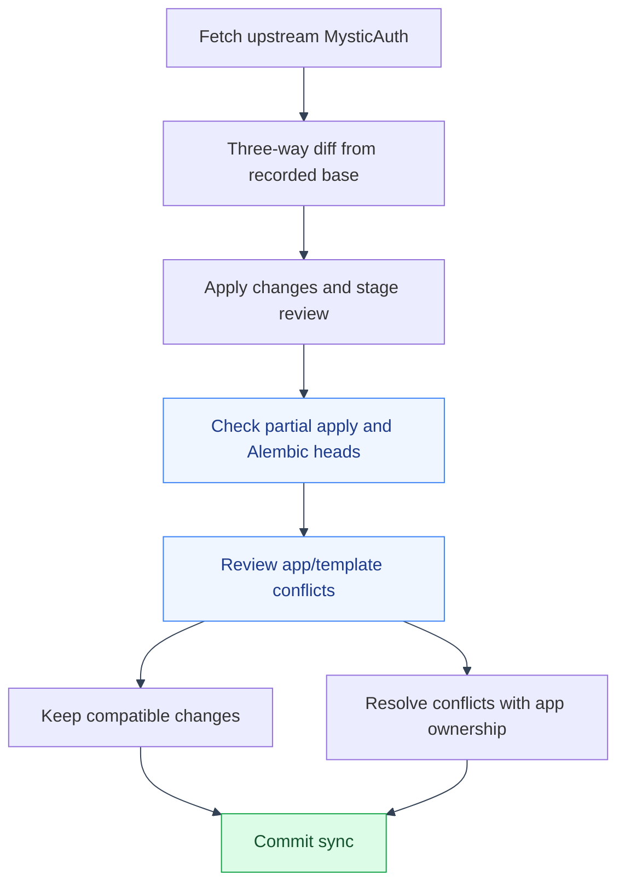

# Syncing with Upstream mystic-auth
---
[`docs/mystic_auth/template-usage/syncing-upstream/README.md`](../mystic_auth/template-usage/syncing-upstream/README.md)
describes `scripts/mystic_auth/upstream-sync/sync-upstream.sh`, the normal way to pull
upstream changes: an incremental three-way diff/apply against the commit
recorded in `.mystic-auth-sync-state`, staged for review before you commit
The current upstream procedure is maintained in that linked document; the
script detects a silent partial-apply (see below) and checks for a branched
alembic history before
letting you commit, instead of relying on this doc to warn you by hand.

**Currently synced to:** mystic-auth commit `9bcbffcace46cff79dfb35c644fe3c9111bc6c0e`
(tracked in
`.mystic-auth-sync-state`, maintained by `scripts/mystic_auth/upstream-sync/sync-upstream.sh`).

---

## Windows gotcha: Git Bash and large patches

---

On Windows, run `scripts/mystic_auth/upstream-sync/sync-upstream.sh` from Git Bash (or
WSL), not PowerShell. Piping a binary-inclusive `git diff` through
PowerShell's pipeline re-encodes it and corrupts the patch.

`git apply` is all-or-nothing per invocation: if upstream's diff includes a
binary file (e.g. a changed `screenshots/*.png`) that can't be resolved
either cleanly or via a 3-way merge, the *entire* patch can silently apply
nothing. The sync script now catches this itself (comparing what the diff
says should have changed against what's actually staged/conflicted
afterward) and refuses to commit if they don't match, rather than leaving
you to notice a suspiciously clean `git status`. If it does report this, the
workaround is still the same: re-run the diff excluding the offending binary
paths (`git diff --binary <last-sha> upstream/main -- . ':!screenshots'`)
and apply that instead; screenshots are this app's own (showing its actual
UI, not the template's generic demo) and don't need to come from upstream
anyway.

The sync script also now runs `scripts/mystic_auth/upstream-sync/check-alembic-heads.sh`
automatically: if upstream added migrations after the point this app's own
migrations were based on, alembic ends up with two heads, and the script
refuses to commit until you rebase this app's migration(s) onto the new
upstream tip (`down_revision` update).

Cloning mystic-auth with git's `core.autocrlf=true` converts every text file
to CRLF on checkout, which can break shell scripts and docker-compose's
multi-line `command: |` blocks if diffed by hand. This repo's own
`.gitattributes` (`eol=lf` on every text file) protects its own checkouts.

---

## See also

---

- [App documentation](README.md)
- [Application flows](flows/README.md)
