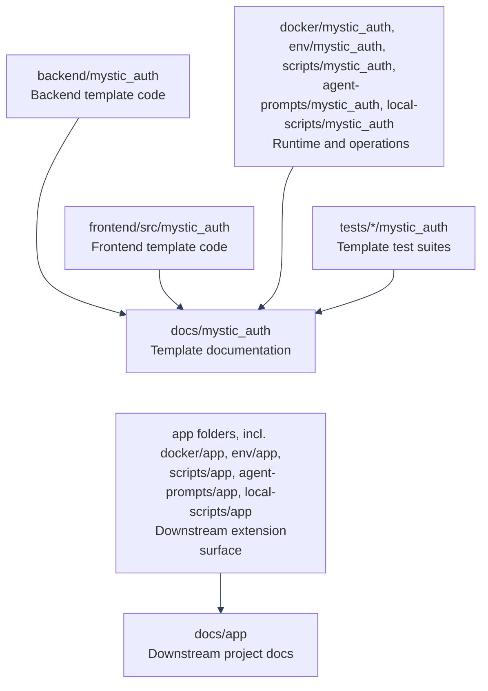

# Implementation Coverage Map
---

*New to a term here? See the [Infrastructure Glossary](../glossary/infrastructure.md) or [Frontend Glossary](../glossary/frontend.md).*

This page maps the current repository implementation to the documentation that explains it. Use it when you need to answer: "Where is this code documented?" It does not replace the deeper topic pages. It points to them and states what each code area owns.

The scope here is the template-owned implementation: `backend/mystic_auth/`, `frontend/src/mystic_auth/`, Docker, env templates, scripts, and tests. App-specific extension folders such as `backend/app/`, `frontend/src/app/`, and `docs/app/` are covered in [Using This Repository as a Template](../template-usage/overview.md).

---

---

## Backend Packages

| Code path | What it owns | Primary docs | Edge cases documented |
|---|---|---|---|
| `backend/mystic_auth/api/` | FastAPI route modules, grouped by feature. | [API Reference](../api/reference.md), [Backend Architecture](backend.md#module-layout) | Mounted OpenAPI paths, auth requirements, list query behavior, `X-Total-Count`, `AppError` shape, and `DELETE /rate-limits/{key:path}`. |
| `backend/mystic_auth/audit_log/` | Security audit model, repository, service logic, and event capture. | [Database Design](../database/design.md#tables), [API Reference](../api/reference.md), [Security Hardening](../security/hardening.md) | Separate security vs authorization audit tables, snapshot emails, audit retention after purge, filters, and sorting. |
| `backend/mystic_auth/auth/` | Signup, login, logout, logout-all, refresh, OAuth2 PKCE, password reset, account verification, current user, tokens, cookies, rate limiting, and lockout. | [Authentication Overview](../authentication/overview.md), [Login](../authentication/login.md), [Logout](../authentication/logout.md), [Session Management](../authentication/session-management/README.md), [Password Reset](../authentication/password-reset.md), [Signup And Verification](../authentication/signup-and-verification.md), [OAuth2 PKCE](../authentication/oauth2-pkce.md) | Timing resistance, lockout order, Valkey outage behavior, idempotent logout, refresh-token reuse scoping, verification expiry, OAuth2 state/PKCE validation, and cookie flags. |
| `backend/mystic_auth/authorization/` | PBAC permission vocabulary, policies, direct grants, cache, evaluator, condition handlers, context builder, dependencies, and authorization audit writes. | [PBAC Architecture](../authorization/architecture/README.md), [Condition Schema Reference](../authorization/condition-schema-reference.md), [Adding Permissions](../authorization/adding-permissions.md), [Writing And Testing Policies](../authorization/writing-testing-policies.md) | Protected baseline policies, caller-holds-what-they-grant checks, cache invalidation, real-time frontend nudges, direct-grant validation gap, condition size/depth limits, and fail-closed evaluation. |
| `backend/app/app_sdk.py` | Downstream startup extension hook for app-owned code, including custom condition handlers and validators. | [Building On This Template](../template-usage/customization.md#backend-customization), [Adding Condition Handlers](../authorization/adding-condition-handlers.md) | `register_extensions()` runs before requests are served; condition registration updates both policy-write validation and runtime evaluation without editing `backend/mystic_auth/`. |
| `backend/app/core/` | App-owned cross-cutting modules, currently including `settings.py` for downstream `BaseSettings` fields. | [Building On This Template](../template-usage/customization.md#first-feature-tutorial), [Backend Settings](../environment/backend.md) | Mirrors `backend/mystic_auth/core/`; product settings stay out of the upstream settings model. |
| `backend/app/core/settings.py` | App-owned `BaseSettings` extension module, including downstream default policy configuration. | [Building On This Template](../template-usage/customization.md#backend-customization), [Backend Settings](../environment/backend.md) | Mirrors the upstream `backend/mystic_auth/core/` layout while keeping app-specific fields out of `mystic_auth.core.settings.Settings`. |
| `backend/mystic_auth/core/` | Settings, structured errors, and shared core primitives. | [Environment Configuration](../environment/README.md), [API Reference](../api/reference.md#error-responses), [Security Decisions: Infrastructure](../security/decisions-infra.md) | `SECRET_KEY` length validation, shared env `extra = "ignore"`, `AppError` translation flow, and backend runtime vs frontend build-time env. |
| `backend/mystic_auth/core/secret_provider.py` | Generic one-secret provider contract and environment-backed provider for downstream applications. | [Downstream Integration Secrets](../security/integration-secrets.md), [Building On This Template](../template-usage/customization.md#backend-customization) | Product providers stay app-owned, values are resolved one at a time, and credentials never enter task arguments, migrations, audit metadata, or logs. |
| `backend/mystic_auth/database/` | Async SQLAlchemy engine, session dependency, and DB lifecycle. | [Database Design](../database/design.md), [Backend Architecture](backend.md#database-layer), [Deployment Guide](../deployment/migrations-and-backups.md#1-database-migrations) | `APP_DATABASE_URL` fallback, Alembic-only schema changes, migration role vs runtime role, and dedicated test database behavior. |
| `backend/mystic_auth/emails/` | Email address normalization, templates, SMTP sending, and enqueue helpers. | [Background Email Delivery](../background-workers/procrastinate.md), [Signup And Verification](../authentication/signup-and-verification.md), [Password Reset](../authentication/password-reset.md) | Disabled email mode, SMTP failure isolation, retry behavior, and links generated from `FRONTEND_BASE_URL`. |
| `backend/mystic_auth/error_monitoring/` | Sentry SDK initialization and Bugsink-compatible exception reporting. | [Error Monitoring](../error-monitoring/overview.md), [Security Decisions: Infrastructure](../security/decisions-infra.md#a-malformed-sentry_dsn-must-never-crash-the-app) | Empty DSN means off, malformed DSN cannot crash startup, late Bugsink DSN watch, and no-op capture when monitoring is unavailable. |
| `backend/mystic_auth/logging/` | Request logging, correlation IDs, access logs, and startup logging. | [Backend Architecture](backend.md#logging), [Security Decisions: Infrastructure](../security/decisions-infra.md#dockerignore-previously-let-local-files-leak-into-built-images), [Docker Validation History](../docker/validation-history.md) | Local access logs excluded from images, correlation ID propagation, and generic client errors without traceback leaks. |
| `backend/mystic_auth/procrastinate_tasks/` | Postgres-backed email and account-lifecycle delivery, account purge, audit-log anonymization, session and refresh-claim cleanup, lifecycle-outbox reconciliation, and worker lifecycle. | [Background Email Delivery](../background-workers/procrastinate.md), [Account Deletion And Purge](../authentication/account-deletion/README.md), [Security Decisions: Infrastructure](../security/decisions-infra.md#taskiq-replaced-with-procrastinate) | No separate scheduler, job persistence in Postgres, retry and failed-job behavior, Alembic-managed queue schema, and periodic task schedules. |
| `backend/mystic_auth/valkey/` | Shared Valkey client singleton and lifecycle. | [Backend Architecture](backend.md#request-pipeline), [Session Management](../authentication/session-management/README.md), [Security Hardening: Infrastructure](../security/hardening-infra.md#valkey-authentication) | Password-authenticated Valkey URLs, shutdown behavior, cache, rate limits, lockout, OAuth2 state, token versions, and SSE Pub/Sub. |
| `backend/mystic_auth/scripts/` | Backend CLI entry points. | [System Superuser](../authentication/system-superuser/README.md), [Unconditioned Policy Quickstart](../authorization/unconditioned-policy-quickstart.md) | Reserved system account creation, promotion of existing accounts, stale token invalidation, baseline policies, and no API endpoint for system account creation. |
| `backend/mystic_auth/user/` | User model, role enum, CRUD helpers, list/search/sort behavior, and schemas. | [API Reference](../api/reference.md), [Database Design](../database/design.md#tables), [Security Decisions: Auth](../security/decisions-auth.md#role-is-never-used-to-decide-access) | Role is display metadata, self vs permission-protected updates, password-change session revocation, sorting/filtering constraints, and soft-deleted rows. |
| `backend/mystic_auth/user_lifecycle/` | Permission-protected and self-service deletion, reactivation, purge, and shared purge service. | [Account Deletion And Purge](../authentication/account-deletion/README.md), [Security Decisions: Product](../security/decisions-product.md#account-lifecycle-soft-delete-by-default), [Database Design](../database/design.md#account-lifecycle) | Soft delete vs purge, grace-period purge job, non-self purge guard, session revocation, audit snapshots, and self-delete current-password confirmation. |
| `backend/mystic_auth/user_session/` | Manage Sessions rows, targeted revoke, SSE session events, and current-session detection. | [Session Management](../authentication/session-management/README.md), [Database Design](../database/design.md#tables), [Frontend Architecture](frontend.md#api-layer) | `chain_id` identity, `current_jti` rotation, self-revoke rejection, real-time permission/session refresh, and graceful SSE shutdown. |

---

## Frontend Folders

| Code path | What it owns | Primary docs | Edge cases documented |
|---|---|---|---|
| `frontend/src/mystic_auth/__tests__/` | Frontend Vitest helpers and template-owned frontend regression tests. | [Testing Overview](../testing/overview.md), [Frontend Test Map](../testing/frontend.md) | Coverage thresholds, providers, routing behavior, and auth state under tests. |
| `frontend/src/mystic_auth/account_settings/` | Profile editing, password changes, appearance controls, self-delete, and app extra tabs. | [Account Deletion And Purge](../authentication/account-deletion/README.md), [Appearance](../appearance/overview.md), [Frontend Customization](../template-usage/frontend-customization.md#shared-chrome-extension-points) | Current-password rules, OAuth-only first password, delete confirmation token flow, unsaved-change warning, and app-supplied tabs. |
| `frontend/src/mystic_auth/api/` | Axios client, typed API wrappers, auth interceptor, error extraction, and translated backend errors. | [Frontend Architecture](frontend.md#api-layer), [API Reference](../api/reference.md), [Translations](../translations/overview/ui-and-errors.md#5-backend-error-codes-frontendsrcmystic_authapiapierrorts) | `withCredentials`, `401` cleanup, translated `AppError` codes, fallback details, `X-Total-Count`, and OAuth2 redirect errors. |
| `frontend/src/mystic_auth/audit_log/` | Security and authorization audit UI tabs, filters, extension props, and list rendering. | [API Reference](../api/reference.md), [Frontend Customization](../template-usage/frontend-customization.md#shared-chrome-extension-points), [Database Design](../database/design.md#why-two-audit-tables-not-one) | Separate audit sources, app resource/action vocabularies, filters, pagination counts, and translated event display. |
| `frontend/src/mystic_auth/auth/` | Login, signup, OAuth2 error display, logout hooks, password reset, verification, current user, and session lifecycle helpers. | [Authentication Overview](../authentication/overview.md), [Login](../authentication/login.md), [Logout](../authentication/logout.md), [Signup And Verification](../authentication/signup-and-verification.md), [Password Reset](../authentication/password-reset.md), [OAuth2 PKCE](../authentication/oauth2-pkce.md) | Cookie-only token storage, query-cache cleanup, translated OAuth2 redirect errors, password rules, resend/confirm flows, and stale-session handling. |
| `frontend/src/mystic_auth/authorization/` | Permission-check hooks and UI helpers that mirror backend PBAC decisions. | [PBAC Architecture](../authorization/architecture/frontend-ui.md#frontend-policy-management-ui), [Frontend Architecture](frontend.md#authorization-on-the-frontend-pbac-aware-ui) | Server remains authoritative, frontend hides controls only, batch permission checks, and stale permission refresh through SSE. |
| `frontend/src/mystic_auth/core/` | Frontend settings and shared constants. | [Environment Configuration](../environment/README.md), [Appearance](../appearance/overview.md) | Build-time `VITE_*` values, fallback app name, support email, default brand color, and logo URL behavior. |
| `frontend/src/mystic_auth/dashboard/` | Dashboard and Manage Sessions card. | [Session Management](../authentication/session-management/README.md), [Frontend Architecture](frontend.md#routing) | Device labels, current-session detection, targeted revoke, SSE events, empty/error states, and query invalidation. |
| `frontend/src/mystic_auth/layout/` | App shell, auth layout, sidebar, navbar, command palette, language/theme controls, and nav extension points. | [Frontend Architecture](frontend.md#routing), [Frontend Customization](../template-usage/frontend-customization.md#shared-chrome-extension-points), [Translations](../translations/overview/README.md) | Permission-gated nav, mixed-language chrome mode, command palette search, app nav/search entries, and responsive layout. |
| `frontend/src/mystic_auth/permissions/` | Permission catalog page and action vocabulary display. | [Adding Permissions](../authorization/adding-permissions.md), [API Reference](../api/reference.md) | Catalog read dependency, enum-backed sensitive permissions, and custom app action strings. |
| `frontend/src/mystic_auth/policies/` | Policy list/detail/edit dialogs, condition editor support, history UI, rollback, assignment, and revoke flows. | [Writing And Testing Policies](../authorization/writing-testing-policies.md), [Condition Schema Reference](../authorization/condition-schema-reference.md), [Policy Examples](../authorization/policy-examples.md) | Protected baseline policies, snapshots, rollback history, condition validation, cache handling, and privilege-escalation guard errors. |
| `frontend/src/mystic_auth/rate_limits/` | Rate Limit Dashboard and reset UI. | [Security Hardening: Abuse Prevention](../security/hardening-abuse-prevention.md#rate-limiting), [API Reference](../api/reference.md) | `key:path` reset route, lockout counters beside rate-limit counters, per-endpoint threshold overrides, and permission-gated reset behavior. |
| `frontend/src/mystic_auth/store/` | Zustand stores for auth, appearance, color mode, language, and client-only preferences. | [Frontend Architecture](frontend.md#state-management), [Appearance](../appearance/overview.md), [Translations](../translations/overview/ui-and-errors.md#3-the-language-store-frontendsrcmystic_authstorelanguagestorets) | Tokens never enter JS state, localStorage persistence, auth cleanup after `401`, and mixed-language resolution. |
| `frontend/src/mystic_auth/theme/` | Tailwind CSS custom properties, brand scale generation, canvas tint, and token wiring. | [Appearance](../appearance/overview.md), [Frontend Customization](../template-usage/frontend-customization.md#frontend-customization) | Env default color, user override color, generated favicon behavior, custom logo URL, and `frontend/src/app/theme.ts` overrides. |
| `frontend/src/mystic_auth/translations/` | Translation setup, shared namespace files, language modes, date/month/numeral formatting, and language toggle data. | [Translations](../translations/overview/README.md), [Adding A Language](../translations/adding-a-language.md) | Twelve shared namespaces plus three app-content namespaces per language, mixed chrome/page language modes, native digits, date formatting outside i18next, and dev warnings for missing error codes. |
| `frontend/src/mystic_auth/ui/` | Shared components grouped by responsibility, plus DataTable, routing wrappers, toaster, network status, styles, table actions, and hooks. | [Frontend Architecture](frontend.md#module-layout), [API Reference](../api/reference.md#list-endpoint-conventions), [Testing Overview](../testing/overview.md) | Table pagination contracts, protected routing, translated toasts, network failure display, and shared icon/button styling. |
| `frontend/src/mystic_auth/users/` | User management, dialogs, bulk operations, queries, role/policy/permission actions. | [API Reference](../api/reference.md), [PBAC Architecture](../authorization/architecture/full-route-list.md#full-route-list), [Frontend Integration Tests](../testing/frontend-integration.md) | Bulk per-item results, `system` role special case, direct permission conditions, self-action guards, soft delete, reactivate, and purge. |

---

## Runtime And Operations

| Code path | What it owns | Primary docs | Edge cases documented |
|---|---|---|---|
| `ci/mystic_auth/` | Upstream-owned native backend, browser, tooling, and backup CI entrypoints. | [CI/CD Overview](../cicd/overview.md), [Test Tooling and CI](../testing/tooling.md) | Keeps MysticAuth audit-log, authorization, accessibility, and permission-matrix failures in blocking, separately named workflow steps. |
| `ci/app/` | App-owned backend and frontend CI entrypoints. | [CI/CD Overview](../cicd/overview.md), [The `app/` + `mystic_auth/` Split](../template-usage/ownership-split.md) | App checks remain separate while shared Docker/Compose orchestration stays in `.github/workflows/ci.yml`. |
| `.github/workflows/ci.yml` | Shared GitHub Actions triggers, services, job orchestration, and combined Docker/Compose validation. | [CI/CD Overview](../cicd/overview.md) | GitHub Actions does not import arbitrary YAML from `ci/`; the workflow invokes executable ownership-specific entrypoints. |
| `docker/mystic_auth/compose/` | Dev, local-prod tunnel variants, and prod Compose files (upstream-owned). | [Docker Overview](../docker/overview.md), [Docker: Compose Modes](../docker/compose-modes.md#two-files-per-mode-mystic_auth--app), [Deployment Guide](../deployment/guide.md), [Local-Prod Deployment](../deployment/local-prod/README.md), [Prod Deployment](../deployment/prod.md) | Explicit project names, healthcheck sequencing, tunnel IP trust, optional GeoIP profile, backup sidecar limits, and production build args. |
| `docker/app/compose/` | A fork's own Compose overrides, one per mode, merged on top of the mystic_auth files above. Ships empty. | [Docker: Compose Modes](../docker/compose-modes.md#two-files-per-mode-mystic_auth--app) | Never edited by upstream again once shipped. |
| `docker/mystic_auth/dockerfiles/` | Backend multi-stage Python image and frontend Vite/nginx image. | [Docker Overview](../docker/overview.md), [Docker Validation History](../docker/validation-history.md), [Security Decisions: Infrastructure](../security/decisions-infra.md) | Runtime vs test backend target, non-root user, production frontend copying only `dist`, `.dockerignore` leak fixes, and `VITE_*` injection. |
| `docker/mystic_auth/postgres-init/` | Postgres bootstrap scripts for extra databases and roles. | [Error Monitoring](../error-monitoring/overview.md), [Docker Overview](../docker/overview.md), [Deployment Guide](../deployment/migrations-and-backups.md#1-database-migrations) | Init scripts only run on fresh volumes, Bugsink database creation, and separation from Alembic app migrations. |
| `env/mystic_auth/` | Mode-specific tracked examples for template-defined fields (upstream-owned), plus git-ignored runtime copies edited by each deployment. | [Environment Configuration](../environment/README.md#the-mystic_auth--app-split), [Deployment Guide](../deployment/environment.md#1-choosing-the-right-env-template) | Backend runtime env, frontend build-time env, Compose-only env, tunnel-specific env, required replacements, and fallback rules. |
| `env/app/` | A fork's own env examples and real env files, one pair per mode, merged on top of the mystic_auth files above. Ships with the app-owned default-policy extension point. | [Environment Configuration](../environment/README.md#the-mystic_auth--app-split) | Never edited by upstream again once shipped. |
| `scripts/mystic_auth/docker/` | Cross-platform stack startup helpers and backend exec helper. | [Docker Overview](../docker/dev-workflow.md#day-to-day-dev-up-helpers), [Testing Overview](../testing/overview.md) | Healthcheck wait behavior, focused logs, Git Bash path conversion, Linux coverage permissions, mode-specific compose/env selection, and the `DEV_UP_TAIL=0` toggle used by `scripts/mystic_auth/env-tools/quickstart/`. `scripts/app/` is reserved for your own scripts. |
| `scripts/mystic_auth/env-tools/setup-env/` | Bootstraps every `env/mystic_auth/.env*` and `env/app/.env*` file (plus `frontend/.env`) from its `.example` in one run. | [Environment Configuration](../environment/README.md), [Template Usage](../template-usage/overview.md) | Skips existing files, generates distinct secrets, derives database URL names from each file's `POSTGRES_DB`, preserves `.bak` branding defaults during sync, and applies one app name/brand color everywhere. |
| `scripts/mystic_auth/env-tools/quickstart/` | One command from a fresh clone to a running dev stack with a login. | [Template Usage](../template-usage/overview.md), [Dev Deployment](../deployment/dev.md) | Runs `setup-env` only if `env/mystic_auth/.env.dev` is missing, reuses `dev-up`'s own readiness wait via `DEV_UP_TAIL=0`, offers system superuser creation inline, safe to re-run. |
| `scripts/mystic_auth/env-tools/check-env/` | Preflight check for a real env file before starting a stack. | [Deployment Guide](../deployment/environment.md#5-required-production-review), [Prod Deployment](../deployment/prod.md) | Fails on a shipped placeholder secret when `ENVIRONMENT=production`, warns on remaining `<your_...>` placeholders, already-bound host ports, and a leftover `.bak` file from a sync; never touches the file. |
| `scripts/mystic_auth/env-tools/set-env-field/` | Sets one or more fields across every env file that already declares each key. | [Environment Configuration](../environment/README.md), [Template Usage](../template-usage/overview.md) | File-based (`shared-values.env`, gitignored, edited normally) or direct `KEY=VALUE` args; skips a file missing a given key instead of adding it; uses `awk`/`.NET regex` with the value passed as data, so slashes/`&`/`$` in a URL or address are safe. |
| `scripts/mystic_auth/env-tools/rotate-secrets/` | Rotates `SECRET_KEY`/`BUGSINK_SECRET_KEY` in place in a real env file. | [Security Hardening: Infrastructure](../security/hardening-infra.md), [Prod Deployment](../deployment/prod.md) | Deliberately scoped to the two secrets safe to rotate by editing the file alone; database-backed secrets (`POSTGRES_PASSWORD`, `APP_DB_PASSWORD`, `BUGSINK_SUPERUSER_PASSWORD`, `VALKEY_PASSWORD`) need a live-service step first and are out of scope on purpose. |
| `scripts/mystic_auth/env-tools/copy-env-values/` | Copies every field from an old env file into a new one, skipping freshly generated secrets. | [Environment Configuration](../environment/README.md), [Syncing with an AI Coding Agent](../template-usage/syncing-upstream/agent-prompt.md) | Prints only field names, never values, so a secret never has to pass through an AI agent's own tool output; flags a field present in the old file but missing from the new one instead of silently dropping it. |
| `agent-prompts/mystic_auth/` | Root-level, ready-to-paste starting prompts for handing common tasks to an AI coding agent. | [Agent Prompts](../../../agent-prompts/mystic_auth/README.md) | New-project setup and upstream sync prompts, both routed through `setup-env`/`copy-env-values` so a real secret never has to pass through the agent's own context. `agent-prompts/app/` is reserved for your own prompts. |
| `scripts/mystic_auth/db/` | Bash backup, restore, restore-drill, freshness, HMAC, alert, and upload helpers plus PowerShell/Command Prompt wrappers. | [Deployment Guide](../deployment/migrations-and-backups.md), [Concerns](../concerns/README.md#database-backups-are-scheduled-integrity-checked-and-shipped-to-backblaze-b2-but-theres-still-no-point-in-time-recovery) | Verified custom-format dumps, restore discipline, `database-restore-drill.sh` proving a dump actually restores into a working database (run in CI), freshness checks, same-host limitation, off-host copy requirement, retention, and no PITR. Windows wrappers delegate to the Bash implementation so all shells share one behavior. |
| `scripts/mystic_auth/upstream-sync/` | Template sync script and regression tests. | [Staying In Sync With Upstream](../template-usage/syncing-upstream/README.md), [Template Usage](../template-usage/overview.md) | Silent partial apply detection, Alembic multi-head detection, git rerere, binary file handling, and executable-bit restoration. |
| `tests/scripts/mystic_auth/env-tools/` | Regression tests for `setup-env`/`check-env`/`rotate-secrets`/`set-env-field`/`copy-env-values`, run against a throwaway copy of `env/`. | [Environment Configuration](../environment/README.md) | The exact `sed -i.bak`/`env/mystic_auth/.env.dev.bak` collision bug found during development, plus each script's core contract (skip-if-exists, distinct secrets per file, excluded-field list). |
| `local-scripts/mystic_auth/` | Upstream local helpers for mode-specific system-user bootstrapping and disposable PBAC permission-matrix seeding. | [System Superuser](../authentication/system-superuser/README.md), [CI/CD Overview](../cicd/overview.md) | System-user helpers cover fresh-account creation only, with ignored `system-user.env` and per-mode Compose targeting. The permission-matrix seed is disposable CI data and validates the lifecycle policy contract. `local-scripts/app/` is reserved for your own local scripts. |

---

## Test Suites

| Code path | What it owns | Primary docs | Edge cases documented |
|---|---|---|---|
| `tests/backend/mystic_auth/unit/` | Backend unit tests for services, helpers, schema behavior, settings, and edge cases. | [Testing Overview](../testing/overview.md), [Backend Unit Tests](../testing/backend-unit.md) | Token logic, condition validation, route helpers, email tasks, settings validation, and fail-safe behavior. |
| `tests/backend/mystic_auth/integration/` | Backend routes and database behavior against real Postgres/Valkey. | [Testing Overview](../testing/overview.md), [Backend Integration Tests](../testing/backend-integration.md) | Auth flows, session rows, PBAC route guards, audit writes, migrations, and dedicated test database separation. |
| `tests/backend/mystic_auth/security/` | Backend security regression tests. | [Backend Security and Performance](../testing/backend-security-performance.md), [Security Hardening](../security/hardening.md) | Privilege escalation, malformed/forged tokens, condition abuse shapes, rate limiting, lockout, and protected policies. |
| `tests/backend/mystic_auth/performance/` | Non-blocking performance regression alarms. | [Testing Overview](../testing/overview.md), [Concerns](../concerns/README.md#performance-tests-are-non-blocking-in-ci) | Shared-runner timing noise, real Postgres/Valkey dependency, and non-blocking CI behavior. |
| `tests/backend/app/` | App extension test placeholder area owned by downstream projects. | [Template Usage](../template-usage/overview.md), [Testing Overview](../testing/overview.md) | Separation from upstream-owned `tests/backend/mystic_auth/`. |
| `tests/frontend/mystic_auth/` | Template frontend behavior tests. | [Frontend Test Map](../testing/frontend.md), [Testing Overview](../testing/overview.md) | Router behavior, query providers, translated states, forms, and user interaction flows. |
| `tests/frontend/app/` | App extension test placeholder area owned by downstream projects. | [Template Usage](../template-usage/overview.md), [Testing Overview](../testing/overview.md) | Separation from upstream-owned `tests/frontend/mystic_auth/`. |

---
