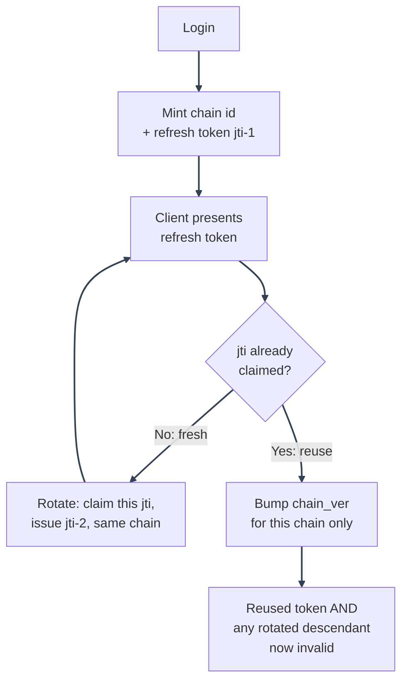

# Session Management: Rotation and Bump Failure Handling

---

*New to a term here? See the [Authentication & Sessions Glossary](../../glossary/authentication.md).*

## Rotation chains and reuse detection

Every refresh token carries a `chain` claim. It is a random id minted once at login and carried forward, unchanged, across every rotation of that login. See `jwt_service.create_refresh_token`, `login_service.py`, `oauth2_service.py`, and `refresh_token_service.refresh_tokens`.

When a refresh token is presented whose `jti` was already claimed (see [Source of truth](README.md#source-of-truth)), a same-IP retry inside the configured grace window is rejected without revoking the first request's chain or minting another child. Older or cross-IP reuse bumps that token's own `chain_ver` (`refresh_token_service.revoke_chain_for_user`), killing the reused token and any descendant in its chain. Every other chain on the account is unaffected because each chain has its own durable version record.

This scoping only applies to `chain_ver`. `account_ver` still gets bumped account-wide for the true whole-account actions (logout-all, password change, deactivation/purge), and access tokens (which carry both numbers, but have no per-device identity beyond their chain) die the instant either their account or chain version goes stale, the same as refresh tokens.

A token minted before chain tracking shipped carries no `chain` claim; reuse of one of those falls back to the original, maximally-safe response (`revoke_all_tokens_for_user`, bumping `account_ver`), since there is no lineage to scope to.

---

## Bump failure handling

A Postgres outage means `bump_account_version`/`bump_chain_version` cannot be confirmed, so nothing was actually revoked. Each caller decides what that means for its own response, rather than one blanket policy:

| Endpoint | Behavior when the bump can't be confirmed |
|---|---|
| `POST /auth/logout/all` | Returns `503` (`SESSION_REVOCATION_UNAVAILABLE`) instead of a false "logged out from N devices". Cookies are still cleared, since this browser's own copy of the goal ("no session left here") is unaffected by whether *other* devices got revoked. |
| `DELETE /auth/sessions/{id}` (Manage Sessions "End session") | Raises before deleting anything from `user_sessions`, so the mirror is not removed while the token backing it is still live. The route turns this into `503` (`SESSION_REVOCATION_UNAVAILABLE`). Ending one specific session is this endpoint's entire purpose, so it must not report success when that didn't happen. |
| `PUT /users/me` password change | The password write itself succeeds independently of the version bump. The response carries `sessions_revoked: false` instead, so the caller (and `ChangePasswordCard.tsx`, which shows a distinct warning toast) can see that the account's *other* sessions were not actually signed out. |
| `PUT /users/{email}` permission-protected password change (`user_management_update_routes.py`) | Same contract as the self-service password change above: the write succeeds, the response carries `sessions_revoked: false` (`UserAdminUpdateResponse`). |
| `POST /auth/password-reset/confirm` | The new password is already written before the revoke is attempted, so a failed bump does not turn a genuine reset into `400 INVALID_RESET_TOKEN_OR_PASSWORD` (it used to, via a broad `except Exception` in `password_reset_service.reset_password` that swallowed the exception - fixed alongside this table). Returns `200` with `sessions_revoked: false`. |
| `DELETE /users/me` self-delete, and `POST /users/me/confirm-delete` (OAuth-only) | Both go through `finalize_self_deletion`, which soft-deletes first and always succeeds regardless of the bump outcome. An unconfirmed bump is logged at `critical` and recorded as `sessions_revoked_confirmed: false` in the `ACCOUNT_DELETED_SELF` audit metadata, but the HTTP response is unaffected - the account really is gone either way. |
| `DELETE /users/{email}` permission-protected delete (`delete_any_user`) | Same reasoning as self-delete: the soft-delete already succeeded, so an unconfirmed bump is logged at `critical` and recorded in the `ACCOUNT_DELETED` audit metadata (`sessions_revoked_confirmed: false`) rather than erroring the request. |
| `DELETE /users/{email}/purge` and the scheduled grace-period purge job | The only revoke-adjacent path that fails **closed**: `purge_user_account` revokes *before* the irreversible hard delete, so an unconfirmed bump propagates and the row is never deleted - better to block a permanent action than purge an account whose sessions might still be alive. The permission-protected route turns this into `503` (`SESSION_REVOCATION_UNAVAILABLE`); the scheduled job catches it per-account so one database outage skips just that account for the day rather than aborting the whole batch. |
| Reuse detection (`_handle_reuse_detected`, internal to `refresh_tokens()`) | Stays fail-closed regardless: the reused token itself is rejected (`refresh_tokens()` returns `None`) whether or not the chain/account bump could be confirmed, since that return already happens unconditionally after `_handle_reuse_detected` runs. The `REFRESH_TOKEN_REUSE_DETECTED` audit event still gets written either way, carrying `metadata.revocation_confirmed: false` when the bump failed, so the gap remains visible in the audit trail even though the immediate request was already safe. |

---

See [Session Management](README.md) for the feature map, or [Real-Time Push](real-time-push.md) for how a revoke reaches other open tabs.

---
