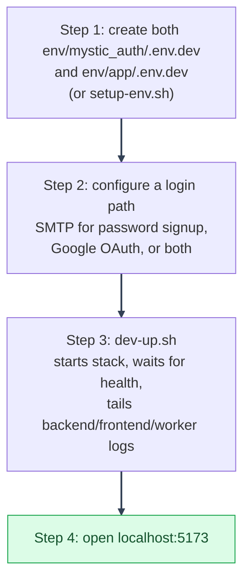

# Dev Deployment
---

*New to a term here? See the [Infrastructure Glossary](../glossary/infrastructure.md).*

Local development: hot reload on both backend and frontend, source
bind-mounted from the host, no TLS. This is the mode you use day to day
while writing code. Start here if you're new to the repo.

Not sure this is the mode you want? See the
[dev vs. local-prod vs. prod comparison](guide.md#1-deployment-modes) in the
Deployment Guide.

---

## Getting started



See [Quickstart](../template-usage/quickstart.md) for the one-command version of all four steps
above, with its own diagram.

---

Want the whole thing in one command instead of the steps below? Run
`scripts/mystic_auth/env-tools/quickstart/quickstart.sh` (`.ps1`/`.cmd`): it does step 1 below
automatically if `env/mystic_auth/.env.dev` doesn't exist yet, brings the stack up, offers
to create the system superuser, then tails logs. See
[Template Usage: Quickstart](../template-usage/quickstart.md).

**Step 1: Copy the env file.**

```bash
cp env/mystic_auth/.env.dev.example env/mystic_auth/.env.dev
cp env/app/.env.dev.example env/app/.env.dev
```

Or run `scripts/mystic_auth/env-tools/setup-env/setup-env.sh` (`.ps1`/`.cmd`) instead of a plain
`cp`: it does this copy (and every other mode's) in one pass, generating a
distinct random secret per password field and applying one app name/brand
color choice everywhere.

`env/mystic_auth/.env.dev.example` is the template half for
`docker/mystic_auth/compose/docker-compose.dev.yml`; `env/app/.env.dev.example`
is the downstream override half. It ships with the empty app-owned
`DEFAULT_APP_POLICIES` extension point, and the MysticAuth defaults are enough
to boot the stack as-is. It uses localhost URLs, development mode,
Docker service names for internal database and Valkey access, and placeholder
third-party credentials.

To test session geolocation in dev, set `GEOIPUPDATE_ACCOUNT_ID`,
`GEOIPUPDATE_LICENSE_KEY`, and
`GEOIP_DB_PATH=/usr/share/GeoIP/GeoLite2-City.mmdb`. The `dev-up.sh` and
PowerShell wrappers automatically enable the `geoip` Compose profile when
that path is non-empty; the MaxMind updater then fills the shared volume
before the backend is considered ready. Raw `docker compose` commands must
include `--profile geoip` themselves. See [Geolocation](../geolocation/overview.md).

Use a different template if you are not running dev:

- Local-prod: copy one of `env/mystic_auth/.env.local-prod-{cloudflare,ngrok,tailscale}.example`
  and use the matching `docker-compose.local-prod-*.yml`. See
  [Local-Prod: which tunnel do I want?](local-prod/README.md#which-tunnel-do-i-want).
- Prod: copy `env/mystic_auth/.env.prod.example` and use `docker-compose.prod.yml`.

See [Choosing the right env template](environment.md#1-choosing-the-right-env-template)
for the quick comparison.

---

**Step 2: Configure a login path.**

The stack can boot without real Google or SMTP values, but a normal user
cannot finish signup and reach the dashboard until one verification path
works:

- Configure `FROM_EMAIL` and `GMAIL_APP_PASSWORD` to support password signup,
  email verification, and password reset.
- Configure `GOOGLE_CLIENT_ID`, `GOOGLE_CLIENT_SECRET`, and
  `GOOGLE_REDIRECT_URI` to support Google login. Google login creates a
  verified account because Google has already verified the email.

The CLI-created system superuser is separate from those normal-user paths. It
is marked verified by the script and can sign in with its password without
Google or SMTP. Regular password signups still need email delivery. See
[System Superuser](../authentication/system-superuser/README.md) for the interactive
command, or `local-scripts/mystic_auth/dev/create-system-user.*` for a non-interactive
version.

See [Environment variables](#environment-variables) below for the runtime
rules, or the [Template Usage Guide](../template-usage/overview.md) for the
full first-run walkthrough (cloning, `env/mystic_auth/.env.dev`, and the first dev-up run).

---

**Step 3: Start the stack.**

```bash
./scripts/mystic_auth/docker/dev/dev-up.sh      # Git Bash, WSL, Linux, macOS
```

```powershell
.\scripts\mystic_auth\docker\dev\dev-up.ps1     # PowerShell
```

```bat
scripts\mystic_auth\docker\dev\dev-up.cmd       # Command Prompt
```

The helper starts the stack detached, restarts `backend` and
`procrastinate_worker` so their startup banners are fresh, waits for health
checks, then tails logs from `backend`/`frontend`/`procrastinate_worker`. See
[Docker Overview: day-to-day dev-up helpers](../docker/dev-workflow.md#day-to-day-dev-up-helpers)
for why this is preferred over running the full dev Compose command directly.

Run the full dev Compose command without `-d` when you want every
service's logs interleaved into one stream, e.g. debugging Postgres/Bugsink/
Alembic startup itself rather than the app.

---

**Step 4: Open the app.**

Frontend: [http://localhost:5173](http://localhost:5173)
API docs: [http://localhost:8000/docs](http://localhost:8000/docs)

The Vite dev server sends CSP, frame denial, `nosniff`, referrer, and
permissions headers. Its CSP allows Vite's development-time inline/eval
scripts and the configured API origin; this is dev-only policy, not the
production frontend policy. HSTS is omitted because this endpoint uses
plain HTTP. Keep the published port loopback-only. If you expose dev over
HTTPS or a tunnel, put it behind the production frontend proxy instead.

---

## Environment variables

The paired `env/mystic_auth/.env.dev.example` and `env/app/.env.dev.example`
files are the source of truth for dev values. They include localhost URLs,
Docker service names, development mode, and placeholders for Google,
SMTP, and Bugsink.

Dev values are read at container startup. If you change backend, database,
Valkey, Google, SMTP, or rate-limit values in `env/mystic_auth/.env.dev`, restart the affected
containers. If you change `VITE_*` values for the Docker frontend dev server,
restart `frontend` so Vite reads the new values.

See [Deployment Guide](environment.md#5-required-production-review)
for what changes once you move to local-prod or prod.

---

## Ports

All published to `localhost` for direct access:

| Service | Port |
|---|---|
| frontend (Vite dev server, HMR) | 5173 |
| backend | 8000 |
| postgres | 5433 by default (`POSTGRES_HOST_PORT`) |
| valkey | 6380 by default (`VALKEY_HOST_PORT`) |
| bugsink | 8010 |

---

## What's different from local-prod / prod

- Source code is bind-mounted (`./backend:/app`, `frontend/`), not baked
  into the image. Edits take effect immediately.
- `backend` runs with `--reload`.
- No `restart:` policy beyond Postgres/Valkey. You restart manually.
- No `alembic: service_completed_successfully` gate on `backend` startup.
- No tunnel, no Caddy: everything is `localhost`-only, no public
  entrypoint.

See [Docker Overview: dev vs. production compose](../docker/compose-modes.md#dev-vs-production-compose)
for the full service-by-service comparison across all three Compose files.

---

## Stopping

```bash
docker compose -f docker/mystic_auth/compose/docker-compose.dev.yml -f docker/app/compose/docker-compose.dev.yml --env-file env/mystic_auth/.env.dev --env-file env/app/.env.dev down
```

Add `-v` to also drop the Postgres/Valkey volumes (wipes local data).

---
