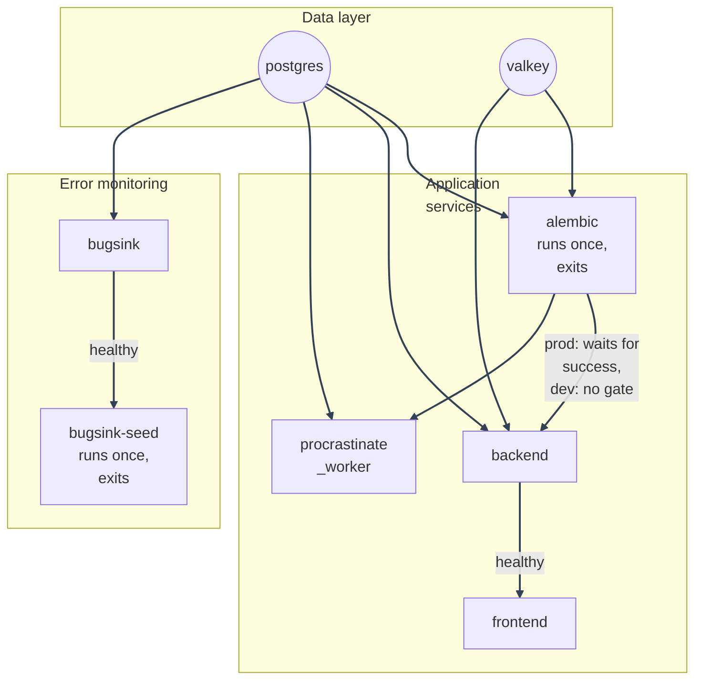

# Docker Overview

---

*New to a term here? See the [Infrastructure Glossary](../glossary/infrastructure.md).*

This stack runs as several Docker Compose services. This page lists them
and links to the detail pages for images, compose modes, healthchecks, and
day-to-day workflow.

## Services

| Service | Image / build | Purpose |
|---|---|---|
| `postgres` | `postgres:15` | Primary database, plus the Procrastinate job queue (`procrastinate_jobs`) |
| `valkey` | `valkey/valkey:9.1.2-alpine` | Cache, rate limits, lockout counters, cached account/chain version counters |
| `backend` | `docker/mystic_auth/dockerfiles/backend.Dockerfile` | FastAPI app (uvicorn) |
| `frontend` | `docker/mystic_auth/dockerfiles/frontend.Dockerfile` (`dev` target locally, `production` target in prod) | React SPA: Vite dev server locally, nginx-served static build in prod |
| `procrastinate_worker` | `docker/mystic_auth/dockerfiles/backend.Dockerfile` (same image as `backend`, different `command:`) | Consumes email and audit-log jobs and runs the scheduled account-purge, audit-retention, session-cleanup, refresh-claim-cleanup, and lifecycle-reconciliation jobs (its own internal periodic-task deferrer, no separate scheduler process): see [Background Workers](../background-workers/procrastinate.md) |
| `alembic` | `docker/mystic_auth/dockerfiles/backend.Dockerfile` (same image, one-shot) | Runs `alembic upgrade head` then exits. In prod, `backend` and `procrastinate_worker` wait on its success |
| `bugsink` | `bugsink/bugsink:2` (pulled, not built) | Self-hosted error monitoring that starts by default with the stack. See [Error Monitoring](../error-monitoring/overview.md) |
| `bugsink-seed` | `bugsink/bugsink:2` (same image, one-shot) | Runs once `bugsink` is healthy. It creates the "MysticAuth" team/project idempotently and writes seeded DSNs into the `bugsink_dsn` volume. Locally, both backend and frontend DSN forms are written and read at startup. In prod, only the backend form is written because `frontend`'s `VITE_SENTRY_DSN` is baked in at image build time |
| `cloudflared` / `ngrok` / `tailscale` | Pulled, not built | The public tunnel, one per `docker-compose.local-prod-*.yml` variant. Proxies `frontend:80` to a public URL and terminates TLS at the provider's edge. See [Local-Prod Deployment](../deployment/local-prod/README.md#which-tunnel-do-i-want) |
| `geoipupdate` | Pinned `ghcr.io/maxmind/geoipupdate` image (pulled, not built) | Optional, off by default (`geoip` Compose profile): keeps `backend`'s GeoLite2-City `.mmdb` file current when valid MaxMind credentials are configured. See [Session Geolocation](../geolocation/overview.md) |
| `db_backup` | `docker/mystic_auth/dockerfiles/db-backup.Dockerfile` | On by default in every production-style Compose file: dumps both databases to `./backups` on a loop. Its dump/upload loop runs as UID/GID 10001 after a short root-owned bind-mount normalization step. See [Deployment Guide: Backups](../deployment/migrations-and-backups.md) |

---

`backend`, `procrastinate_worker`, and `alembic` all build from
the same `docker/mystic_auth/dockerfiles/backend.Dockerfile` image with different `command:`
overrides. This keeps dependency versions and application code identical
across all three roles.

The `postgres` service mounts `docker/mystic_auth/postgres-init/` to
`/docker-entrypoint-initdb.d/`. On a fresh volume, it creates the separate
`bugsink` database, so Bugsink does not need a second Postgres container.

Production-style Compose modes isolate Postgres and Valkey on separate
internal networks. `backend` and `procrastinate_worker` join both data
networks; `alembic`, Bugsink, and its seed service join only `postgres_net`.
The backup sidecar joins `postgres_net` and its dedicated upload egress
network, but never joins Valkey's network. `geoipupdate` uses only its egress
network and the shared GeoIP volume. The public frontend and tunnel stay on
`frontend_proxy`; only `backend` joins that network, so the frontend cannot
reach either data service directly. Backend outbound OAuth and SMTP traffic
uses a separate egress network.

---

## Startup order

---

## More on this topic

- [Dockerfiles](dockerfiles.md): the backend and frontend image build stages, `nginx.frontend.conf`, `.dockerignore`, and why `frontend` sets `pull_policy: build`.
- [Compose Modes](compose-modes.md): dev vs. production compose differences, and why each compose file declares its own Compose project name.
- [Healthchecks](healthchecks.md): the per-service healthcheck table.
- [Dev Workflow](dev-workflow.md): the dev-up helper scripts, running one-off commands inside a container, and why `/app/logs` is a named volume.
- [Docker Validation History](validation-history.md): live verification notes.

---
