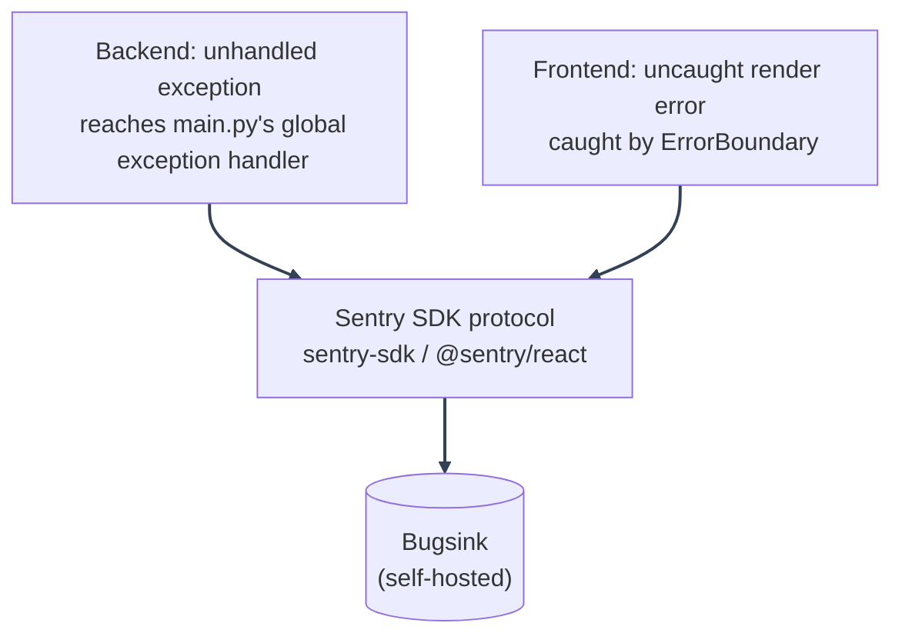

# Error Monitoring
---

*New to a term here? See the [Operations Glossary](../glossary/operations.md).*

Enabled by default via self-hosted Bugsink. This template ships the wiring to report unhandled backend exceptions and frontend render crashes to an error-tracking service: the Bugsink container starts automatically with the stack and the SDKs make zero calls only if you clear `SENTRY_DSN`/`VITE_SENTRY_DSN` yourself.

---

## Why Bugsink

Both the backend and frontend integrations speak the **Sentry SDK wire protocol**: the same protocol Sentry itself, [GlitchTip](https://glitchtip.com/), and [Bugsink](https://www.bugsink.com/) all implement. Nothing here is tied to Sentry-the-company specifically; only the SDK package names (`sentry-sdk`, `@sentry/react`) are.

This template documents **self-hosted Bugsink** as the default path, for reasons specific to what this template is:

- **This is an auth + PBAC template.** Error payloads (stack traces, request context) can carry emails and other PII. Self-hosting keeps that data on your own infrastructure instead of a third-party SaaS by default.
- **Lightweight.** Bugsink is a single Django app: no Valkey, no Celery, no split frontend/backend containers. It reuses the same Postgres server this template already runs (a second database, not a second container: see `docker/mystic_auth/postgres-init/init-bugsink-db.sh`).
- **License**: Bugsink is [PolyForm Shield](https://polyformproject.org/licenses/shield/1.0.0/): source-available, not OSI-approved open source. In plain terms: free to self-host and modify, with one restriction: you can't use it to build a *competing* error-tracking product. Using it to monitor errors in an unrelated app (this one) isn't a competing use, so this doesn't affect you or this template's own MIT license (Bugsink runs as a fully separate service you only talk to over HTTP: nothing from it is copied into or distributed with this repo).

---

## Quickstart (self-hosted Bugsink)

No external account or sign-up is involved anywhere in this path: Bugsink is entirely self-hosted, and the only "credentials" are the superuser login you make up yourself in step 1.

**Starting the stack with a dev-up helper or plain `docker compose up` starts Bugsink by default**: see [Docker Overview: services](../docker/overview.md#services) for the full service breakdown. All you need to do is set the variables in step 1 below before you first bring the stack up.

---

1. **Set the Bugsink-specific variables in `env/mystic_auth/.env.dev`** (see `env/mystic_auth/.env.dev.example`):

   ```bash
   BUGSINK_SECRET_KEY=<run: openssl rand -base64 50>
   BUGSINK_SUPERUSER_EMAIL=<your email>
   BUGSINK_SUPERUSER_PASSWORD=<a strong password>
   BUGSINK_BASE_URL=http://localhost:8010
   ```

   These configure the Bugsink *container* directly: they are unrelated to this app's own `Settings` class and never read by the backend/frontend themselves. `BUGSINK_BASE_URL` is what Bugsink uses to construct links back to itself (e.g. in any email it sends): `http://localhost:8010` is only correct for local dev; update it to match wherever you're actually reaching Bugsink from (a LAN IP, a tunnel, a real hostname) if that's not `localhost`.

   **`BUGSINK_SECRET_KEY` specifically must be a real, long value.** Leave it as `env/mystic_auth/.env.dev.example`'s placeholder and the `bugsink` container crash-loops on startup (Django's own deploy check rejects short/low-entropy secret keys): you'll see it endlessly restarting in `docker compose ps`/logs. This doesn't affect anything else: `backend`, `frontend`, and every other service start and work normally regardless, since nothing depends on `bugsink` being healthy. If you don't want error monitoring at all, either set a real key anyway (cheapest fix, `openssl rand -base64 50`) or run `docker compose stop bugsink bugsink-seed` to stop the restart loop.

   **Email notifications on a new issue reuse this app's own mail settings.** Every Compose file's `bugsink` service maps `SMTP_HOST`/`SMTP_PORT`/`FROM_EMAIL`/`GMAIL_APP_PASSWORD` (already set for this app's own signup/reset emails, see [Authentication Overview](../authentication/overview.md)) onto Bugsink's own env var names (`EMAIL_HOST`/`EMAIL_PORT`/`EMAIL_HOST_USER`/`EMAIL_HOST_PASSWORD`/`DEFAULT_FROM_EMAIL`, plus `EMAIL_USE_TLS: "true"`). Bugsink is a separate Django app with its own settings, so it never reads this app's `Settings` class regardless of naming. No extra setup needed: as long as the mail vars above are real, a brand-new issue (not a repeat event on one already seen) emails the project's members automatically. Without a real `SMTP_HOST`, Bugsink silently falls back to writing to its own console log instead of sending anything: check `docker compose logs bugsink` for `QuietConsoleEmailBackend` if notifications seem to be missing.

---

2. **Start it** (part of the normal quickstart: no extra flag needed):

   ```bash
   docker compose -f docker/mystic_auth/compose/docker-compose.dev.yml -f docker/app/compose/docker-compose.dev.yml --env-file env/mystic_auth/.env.dev --env-file env/app/.env.dev up -d
   ```

   First boot runs Bugsink's own database migrations against the `bugsink` database (created automatically by `docker/mystic_auth/postgres-init/init-bugsink-db.sh`: see that file's own comment if you're enabling this against an *already-initialized* `postgres_data` volume, since init scripts only run once, against a fresh volume) and creates the superuser from step 1.

---

3. **That's it: no manual project/DSN setup.** Once `bugsink` reports healthy, the one-shot `bugsink-seed` service (`docker-compose.dev.yml`) runs automatically: it creates a "MysticAuth" team and project via Bugsink's Django ORM (idempotent: safe to run on every `up`), then computes both DSN forms itself and writes them to a small shared Docker volume that `backend`/`frontend` read from at their own startup:

   ```
   SENTRY_DSN=http://<key>@bugsink:8000/<id>        # backend: reaches Bugsink over the Docker network
   VITE_SENTRY_DSN=http://<key>@localhost:8010/<id> # frontend: reaches Bugsink from the browser, via its published host port
   ```

   (This two-host split, `bugsink:8000` internally vs. `localhost:8010` from the browser, used to be a manual, easy-to-miss trap when copy-pasting a single DSN Bugsink's UI showed you. `bugsink-seed` computes both forms directly from the project's id/key, so there's nothing to copy-paste or get wrong.)

   `backend`'s and `frontend`'s own `command:` in `docker-compose.dev.yml` wait briefly (bounded at ~10s) for `bugsink-seed` to finish writing these before starting their real process. That covers a warm restart (Bugsink already healthy) reliably, but not a fresh boot (first clone, or after `docker compose down -v`): Bugsink itself can take 20+ seconds to become healthy on a cold start (its own ~150 first-boot migrations), past that 10s window.

   **`backend` has a second layer for exactly that case**: `error_monitoring/sentry_service.py`'s `watch_for_late_dsn()`, started as a background task from `main.py`'s lifespan, keeps polling the same file with no fixed assumption about how long Bugsink takes, and picks it up whenever it actually appears. `frontend` doesn't have this second layer. Vite's dev server reads `VITE_*` at process start with no clean hot-reload path, so a fresh boot can genuinely leave frontend monitoring off until the container's next restart; lower stakes than backend missing it, since it's dev-only and a page reload after that restart picks it up.

   You can still log in at `http://localhost:8010` with the superuser credentials from step 1 to browse the "MysticAuth" project's Issues list directly.

   **In production-style Compose files, this same auto-wiring exists for `backend` only, not `frontend`.** `bugsink-seed` and the shared `bugsink_dsn` volume are present there too, and `backend`'s DSN is auto-wired identically: it's a container-to-container address (`bugsink:8000`) either way, so nothing about it changes between dev and prod. `frontend` is different: `VITE_SENTRY_DSN` is baked into the static bundle as a Docker build arg (see [Deployment Guide](../deployment/guide.md)), not read at container startup, and it needs whatever address *publicly* reaches Bugsink in production: a reverse-proxy route you set up deliberately (see [Security notes](#security-notes) below), which `bugsink-seed` has no way to know in advance. Set `VITE_SENTRY_DSN` manually in that mode's `env/mystic_auth/.env.local-prod-*`/`env/mystic_auth/.env.prod` before building the matching production-style Compose file once you know that address; there's no auto-wiring to wait for on the frontend side in production.

---

4. **Verify it actually works**: don't just trust the config, trigger a real error and confirm it shows up in Bugsink's UI:

   ```bash
   docker compose -f docker/mystic_auth/compose/docker-compose.dev.yml -f docker/app/compose/docker-compose.dev.yml --env-file env/mystic_auth/.env.dev --env-file env/app/.env.dev exec backend sh -c '. /shared/bugsink-dsn/backend.env 2>/dev/null; python -c "
   import sentry_sdk
   from mystic_auth.error_monitoring.sentry_service import init_sentry, capture_exception
   import asyncio

   init_sentry()
   try:
       raise ValueError(\"manual verification error\")
   except ValueError as exc:
       asyncio.run(capture_exception(exc))
   sentry_sdk.flush(timeout=10)  # the SDK sends asynchronously: without an explicit
                                  # flush, this one-off script can exit before the
                                  # background transport thread gets to send anything
   "'
   ```

   (The leading `. /shared/bugsink-dsn/backend.env` sources the seeded `SENTRY_DSN` into this one-off shell: `docker compose exec` starts a fresh process using the container's baseline env, not whatever the running `backend` process's own entrypoint already exported into itself, so without this the DSN this command sees would be empty/stale even though the real app has the right one. Harmless no-op: `2>/dev/null`: if you've turned monitoring off by clearing `SENTRY_DSN`.)

   Open your project in Bugsink within a few seconds and confirm a
   `ValueError: manual verification error` Issue appeared. Delete it afterward
   from Bugsink's own UI. This is a one-time sanity check, not something to
   leave in your issue list. The UI delete action handles related rows correctly;
   a raw Django ORM `.delete()` may hit foreign-key errors.

---

To turn it off again: clear `SENTRY_DSN`/`VITE_SENTRY_DSN` (or just don't set them): every capture call becomes a no-op immediately, no restart of Bugsink itself required. The `bugsink` container can keep running or be stopped independently (`docker compose stop bugsink bugsink-seed`), or removed from the stack entirely by deleting its service block from the Compose file you run if you don't want it at all.

---

## Using Bugsink

Written for whoever's never touched Bugsink (or Sentry, or any error tracker like this) before: the concepts, not a pixel-perfect UI tour, since the UI itself is simple enough that "what am I even looking at" is the only real barrier.

- **Issues, not raw events.** Once error reporting is on, you don't watch a live feed: you open `http://localhost:8010` (or wherever `BUGSINK_BASE_URL` points) and check your project's **Issues** list when you actually want to know what's broken. An Issue is one *kind* of error, automatically deduplicated: the same exception happening 500 times shows up as one Issue with a count of 500, not 500 separate rows. That count, plus "first seen"/"last seen" timestamps, is usually enough on its own to tell a one-off blip from something actively breaking right now.
- **Opening an Issue** shows the exception type and message, the full stack trace (which file/line/function, down to the frame that actually raised it), and: for backend errors: the caller's email if `capture_exception` could resolve one from their session (see [User context](#user-context) below). There's no request-body/header dump beyond that; this integration deliberately doesn't send that (see [Security notes](#security-notes)).
- **Resolving an Issue** marks it as fixed: it moves out of your default "unresolved" view. If the exact same error happens again later, Bugsink reopens it automatically (a "regression") rather than silently starting a fresh, disconnected Issue: so resolving something is a real claim ("I fixed this"), not just archiving it.
- **Muting an Issue** is different from resolving: use it for something you've deliberately decided isn't worth fixing right now (a known third-party flake, noise from an edge case you're accepting): it stays out of your unresolved view without claiming you fixed anything.
- **Projects and teams**: one Bugsink instance can hold multiple projects (e.g. if you later stand up another service pointed at the same Bugsink), each with its own DSN and its own Issues list, grouped under teams for who can see what. For a single-app setup like this template's default, one project is all you need.
- **You won't see anything until something actually breaks.** There's no seed data: a fresh project's Issues list is empty by design. If you want to confirm the pipe works before waiting for a real bug, use the verification command in step 4 above.

---

## What gets reported, and from where

| Layer | Trigger | Where |
|---|---|---|
| Backend | Any exception that reaches `main.py`'s global exception handler (i.e. anything not already turned into a normal HTTP error response by a route) | `backend/mystic_auth/error_monitoring/sentry_service.py::capture_exception` |
| Backend (manual) | Anything your own route/service code catches but still wants tracked | `capture_exception`, re-exported from `backend/app/sdk.py` |
| Frontend | An uncaught render error anywhere in the component tree | `frontend/src/mystic_auth/ui/routing/ErrorBoundary.tsx` calls `core/errorMonitoring.ts::reportError` |
| Frontend (manual) | Anything your own component/hook code catches but still wants tracked | `reportError`, re-exported from `frontend/src/app/sdk.ts` |
| Frontend (automatic) | Uncaught `window.onerror`/unhandled promise rejections | Sentry SDK's own default browser instrumentation, once initialized |
| Security alerting | Refresh-token replay, SSE connection-cap, and login lockout threshold events | `capture_security_alert()` sends a tagged error event (`security_event`) to Bugsink/Sentry and, when configured, a JSON POST to the direct webhook; the durable audit log remains the source of truth |

---

## Direct security-alert webhook

The direct webhook is an optional second notification route for operators who
already have an incident gateway or alerting service that accepts authenticated
HTTP webhooks. It is not required for normal operation. If it is left blank,
the application still writes the durable audit event and still sends the
security event to Bugsink/Sentry when `SENTRY_DSN` is configured.

### What it detects

The application sends one alert when it detects one of these high-signal
events:

- `refresh_token_reuse_detected`: a refresh token was presented again outside
  the normal duplicate-request grace period or from a different client IP. The token chain is revoked when
  possible, and the event records whether revocation was confirmed.
- `session_event_connection_limit_exceeded`: an account or client IP reached
  the maximum number of live session-event (SSE) connections.
- `account_locked`: a login failure crossed either the per-account or
  per-source-IP lockout threshold. The application emits one alert when the
  threshold is crossed; repeated requests while the account/IP is already
  locked are recorded in the durable audit log but do not generate an alert
  storm. Metadata identifies the lock scope, target email, source IP, and
  correlation request ID, never a password or token.

These are not ordinary individual login failures or routine `403`/`404`
responses. They can indicate token theft, credential spraying, deliberate
account lockout, abuse, or a broken client opening streams repeatedly.

### What to put in the environment file

The settings belong in the matching mode file, for example
`env/mystic_auth/.env.prod`:

```dotenv
# The HTTPS POST endpoint supplied by your incident gateway.
SECURITY_ALERT_WEBHOOK_URL=https://alerts.example.com/hooks/mystic-auth

# Optional bearer credential issued by that gateway.
SECURITY_ALERT_WEBHOOK_TOKEN=<gateway-issued-token>

# Seconds to wait for the gateway. 2 is the normal default.
SECURITY_ALERT_WEBHOOK_TIMEOUT_SECONDS=2
```

Use a separate URL and token for production, staging, and development when
those environments notify different destinations. Do not put a Bugsink DSN,
Slack signing secret, database password, JWT secret, or user password in
`SECURITY_ALERT_WEBHOOK_TOKEN`. It must be the bearer credential expected by
the receiving HTTP endpoint.

If you do not already have an incident gateway, leave all three settings at
their shipped empty/default values. This repository does not create a webhook
endpoint or provision an account with PagerDuty, Slack, Opsgenie, or another
provider.

### Where the URL and token come from

The URL comes from the receiving system's **incoming webhook**, **generic HTTP
receiver**, or an internal service owned by your operations team. The token
comes from that same system when it supports bearer authentication. Ask the
operations owner for:

1. an HTTPS endpoint that accepts `POST` requests with `Content-Type:
   application/json`;
2. the bearer token, if authentication is enabled; and
3. the expected success response (this application treats any `2xx` response
   as success).

Provider-specific incoming webhooks are not automatically interchangeable.
For example, a Slack or PagerDuty integration may require its own payload
shape rather than this generic JSON shape. Use a provider's generic webhook
receiver or put a small adapter/internal gateway in front of it. The adapter
can translate this payload into the provider's required format.

### What the application sends

For every detected event, the application sends a JSON body like this:

```json
{
  "event_type": "refresh_token_reuse_detected",
  "environment": "production",
  "occurred_at": "2026-01-15T03:04:05.000000+00:00",
  "metadata": {
    "chain_id": "example-chain-id",
    "revocation_confirmed": true
  }
}
```

The second event type has `account_limit` and `ip_limit` in `metadata` instead.
The metadata is deliberately limited: the webhook does not receive passwords,
refresh tokens, access tokens, or request bodies. The optional token is sent
only in the HTTP `Authorization: Bearer ...` header and is never included in
the JSON body or application logs.

### Delivery and failure behavior

The backend makes one HTTP `POST` per security event. It uses the configured
timeout, defaults to two seconds, and treats delivery as best effort. A timeout,
network error, or non-`2xx` response is logged as a webhook failure but does
not turn the authentication request into a `5xx` response. The database audit
event remains the source of truth, and Bugsink/Sentry reporting is independent
of the direct webhook.

Before connecting the application, you can verify that your receiver accepts
the contract with a harmless sample request:

```bash
curl --fail-with-body --silent --show-error \
  -X POST 'https://alerts.example.com/hooks/mystic-auth' \
  -H 'Content-Type: application/json' \
  -H 'Authorization: Bearer <gateway-issued-token>' \
  --data '{
    "event_type": "webhook_configuration_test",
    "environment": "production",
    "occurred_at": "2026-01-15T03:04:05.000000+00:00",
    "metadata": {"source": "manual-test"}
  }'
```

Then set the variables in the relevant env file and restart/recreate the
backend service so it receives the new values. Check the receiver's delivery
log and the backend logs after a real security event. Do not use a real token
in shell history or paste one into tickets or chat.

**Not reported automatically**: a normal `403`/`404`/validation error: those are expected API responses handled by the calling code (a toast, an inline `FormAlert`), not exceptions. Reporting every expected error response would drown out the events that actually indicate a bug.



---

## User context

The backend attaches the caller's email (read from their `access_token` cookie, best-effort: a missing/expired/invalid cookie just means no user context, never a failure to capture) so an error can be traced back to who hit it. Deliberately narrow: only an email is attached, not the SDK's broader automatic PII collection (request bodies, full cookie jars, etc.), which could otherwise capture credentials in transit: see `error_monitoring/sentry_service.py::init_sentry`'s own comment on `send_default_pii`.

---

## Security notes

- **Bugsink needs its own operational security**, same as Postgres/Valkey already do in this stack: self-hosting only guarantees the *data* stays on your infrastructure, not that the service is automatically locked down. It has no host port exposed in production-style Compose by default (unlike the frontend entrypoint): reaching it in production means an SSH tunnel, a VPN, or a reverse-proxy route you add deliberately, not something exposed by default.
- **Traces are 0% sampled** (`traces_sample_rate: 0` / `tracesSampleRate: 0`): this integration is error capture only, not performance monitoring/tracing. No request-body/timing data is sent beyond what an actual captured exception includes.
- **`SECRET_KEY` vs. `BUGSINK_SECRET_KEY`**: these are two unrelated secrets for two unrelated purposes (this app's JWT signing key vs. Bugsink's own Django secret key): never reuse one for the other.
- **A typo'd `SENTRY_DSN` can't take the app down.** `init_sentry()` runs at import time, before the app itself really exists: it deliberately catches any failure from `sentry_sdk.init()` (verified directly: a malformed DSN string does raise from the SDK) and logs a warning instead of letting it propagate, so a mistake in this one *optional* setting degrades to "monitoring is off" rather than "nothing works." See [Security Decisions](../security/decisions-infra.md#a-malformed-sentry_dsn-must-never-crash-the-app).
- **Configure a notification rule for `security_event`, or use the direct webhook.** Refresh-token replay and SSE-cap violations are written to the database audit log and emitted as tagged error events to the configured Bugsink/Sentry endpoint. `SECURITY_ALERT_WEBHOOK_URL` can additionally deliver a metadata-only JSON event directly to an internal incident gateway; `SECURITY_ALERT_WEBHOOK_TOKEN` supplies bearer authentication. Production operators must configure and test at least one notification integration. The application deliberately does not send security data by email or include tokens in the event.

---

## Alternative: GlitchTip

[GlitchTip](https://glitchtip.com/) is another real option if you outgrow Bugsink or prefer a fully OSI-approved-open-source (MIT) self-hosted alternative: same DSN-swap story, but heavier to run (needs Valkey + Celery + a split frontend/backend on top of Postgres, vs. Bugsink's single container). Not documented step-by-step here since Bugsink already covers the "lightweight, self-hosted, license-compatible" niche this template optimizes for: but nothing in the integration code assumes Bugsink specifically.

---
