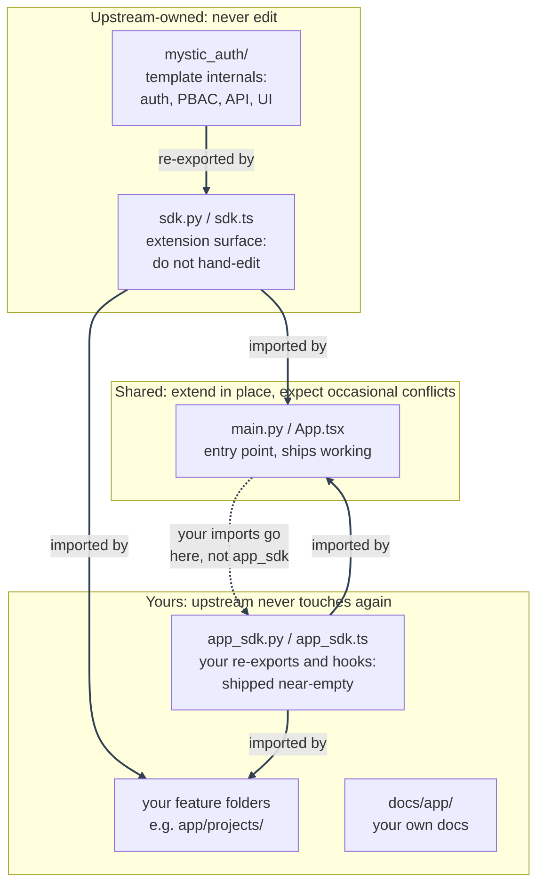

# The `app/` + `mystic_auth/` Split

---

*Part of [Using This Repository as a Template](overview.md). This is the file-ownership convention that makes [staying in sync with upstream](syncing-upstream/README.md) low-conflict: which files you can edit freely, which you should never touch, and which are shared and expect the occasional merge conflict.*

Both backend and frontend are split into two trees, and every file in the repo falls into exactly one of three ownership tiers. This is primarily a **file-path convention**: there is no `CODEOWNERS` or custom merge driver, though the upstream sync script blocks changes to downstream-owned paths and permits a few documented exceptions. Knowing which tier a file is in tells you whether you can edit it freely, should never edit it, or should expect the occasional merge conflict there.

---

| Tier | Files | Who edits it | Why |
|---|---|---|---|
| **Upstream-owned: never edit** | `backend/mystic_auth/`, `backend/app/sdk.py`, `frontend/src/mystic_auth/`, `frontend/src/app/sdk.ts`, `ci/mystic_auth/`, `docs/mystic_auth/`, `screenshots/mystic_auth/`, `scripts/mystic_auth/`, `agent-prompts/mystic_auth/`, `local-scripts/mystic_auth/`, tracked `docker/mystic_auth/`, tracked `env/mystic_auth/*.example`, `makefiles/mystic_auth/`, root `Makefile`/`make.ps1` | Only upstream | This is the template's source. Since you never hand-edit it, upstream syncs can replace it cleanly. The untracked runtime env copies under `env/mystic_auth/` are deployment state and are intentionally edited by the project owner; keep app-only variables in `env/app/`. |
| **Yours: upstream never touches it again** | `backend/app/app_sdk.py`, `backend/app/core/settings.py`, `frontend/src/app/app_sdk.ts`, `frontend/src/app/theme.ts`, `ci/app/`, `docs/app/`, `screenshots/app/`, `scripts/app/`, `agent-prompts/app/`, `local-scripts/app/`, `docker/app/`, `env/app/`, `makefiles/app/`, root `README.md`, `SECURITY.md`, `CONTRIBUTING.md` | Only you | Upstream ships these once (`app_sdk.*`/`theme.ts` near-empty, with the backend hook and frontend theme override ready for additions; `core/settings.py` contains the app-owned settings starting point; the READMEs as generic starting points; `app/` script/prompt/compose/makefiles folders empty) and never edits them again in any future release. Since only you write to them, they never conflict either. |
| **Shared: extend in place, expect occasional conflicts** | `backend/app/main.py`, `frontend/src/app/App.tsx`, plus root-level config neither side owns outright: `frontend/package.json`, `backend/requirements.txt`, `backend/alembic.ini`, `backend/pyproject.toml`, `.github/workflows/ci.yml`, `.vscode/settings.json`, `pytest.ini`, `CLAUDE.md`, `.gitignore`, `.dockerignore`, `docker/tailscale-serve-config.json` | Both, over time | These have to ship as real, working files (an entry point that mounts routers, a router that renders routes, a dependency list, a CI pipeline, ignore rules, a JSON config a tool expects at one specific path with no include mechanism of its own), so they can't start empty the way `app_sdk.*` does, and each has to stay a single file per its own tool's convention rather than splitting into `app/`/`mystic_auth/` folders. You're expected to extend them (register your own router, add your own `<Route>`, add your own CI job, ignore your own generated paths, add your own Tailscale serve handler), and upstream may also touch the same file later (e.g. a middleware-ordering fix, or a dependency swap). This is the one tier where a sync merge can genuinely conflict, and it's a normal, expected part of syncing when it happens. |

---

The upstream sync permits comment-only maintenance in
`frontend/src/app/main.tsx` and `frontend/src/app/theme.ts` so template
comments can stay accurate without taking ownership of downstream behavior.
Any executable-code change in either file remains blocked as an ownership
violation; a downstream edit to the same comment can still produce a normal
three-way conflict.

---

`sdk.py`/`sdk.ts` re-export the pieces you're meant to build on (`require_authorization`, `Permission`, `useAuthorization`, `ProtectedRoute`, the shared `api` client, and more): import from there, not from internal `mystic_auth/` paths directly.

The root `README.md`, `SECURITY.md`, and `CONTRIBUTING.md` are maintained in
the upstream repository as part of its own documentation, but a downstream
project owns its copies after the template is created. `sync-upstream.sh`
reports and excludes changes to those three root files, so upstream can keep
improving its source README without overwriting a downstream project's
product documentation.

Your own new feature folders (`backend/app/projects/`, `frontend/src/app/projects/`) are effectively a fourth, unlisted case: upstream has no idea they exist, so they behave like the "yours" tier automatically, with no path convention needed.

The diagram above only shows code files, since it's tracing import relationships; the shared config files from the table above (`package.json`, `requirements.txt`) don't import anything, but they're in the same "Shared" tier as `main.py`/`App.tsx` for the same reason: you're expected to add your own entries, and upstream may add or change its own later. See [Syncing Upstream Template Updates](syncing-upstream/README.md) for what a conflict in one of these actually looks like.

Compose source files and env templates aren't in the Shared tier: each got the same `mystic_auth/`/`app/` split as everything else (`docker/mystic_auth/compose/` + `docker/app/compose/`, `env/mystic_auth/` + `env/app/`). Do not edit tracked `docker/mystic_auth/` files; put Compose changes in the matching `docker/app/compose/` override. Runtime copies such as `env/mystic_auth/.env.prod` are local deployment state, not upstream source, and may be edited. Every template script passes both `-f` flags and both `--env-file` flags (mystic_auth's, then app's, so an app-declared value wins on overlap) - see [Docker: Compose Modes](../docker/compose-modes.md).

CI follows the same split through `ci/mystic_auth/` and `ci/app/`. The shared
`.github/workflows/ci.yml` is the orchestration file: it owns triggers,
services, combined Docker/Compose checks, and the final assembled-system
coverage. It calls the ownership-specific scripts for native backend,
frontend, tooling, and backup checks. GitHub Actions cannot import arbitrary
YAML from a root `ci/` directory, so the split files are executable scripts;
workflow job definitions remain in `.github/workflows/ci.yml`.

The same split reaches the rest of `docker/` too:

### How to decide where a change goes

Use this decision path before creating or editing a file:

1. Is it reusable authentication, PBAC, session, audit, database, or shared UI behavior? Consume it through the SDK from your app code. If the reusable template behavior is missing or needs a fix, propose that upstream; do not edit `backend/mystic_auth/` or `frontend/src/mystic_auth/` in a downstream project.
2. Is it product behavior, product configuration, a custom resource, custom policy/action, branding, legal copy, or project-specific integration? Put it under `backend/app/` or `frontend/src/app/`. App-owned backend cross-cutting configuration belongs specifically in `backend/app/core/settings.py`, mirroring `backend/mystic_auth/core/settings.py`; app-owned frontend shared configuration belongs in `frontend/src/app/core/`.
3. Is it a deployment or environment change? Put it in the corresponding `docker/app/`, `env/app/`, `scripts/app/`, or `makefiles/app/` location. Merge both Compose files and both env files; the app file is loaded last, so its values win on overlap.
4. Is it a test? Put template regression tests under `tests/**/mystic_auth/` and downstream feature tests under `tests/**/app/`, mirroring the code they cover. Some reference-app tests shipped with this template predate a downstream split and may already live under `tests/**/app/`; identify those from the upstream baseline rather than treating every inherited test as downstream product code. If such a test hard-codes a configurable default, fix the test upstream and keep the downstream product configuration unchanged.

There is one deliberate bridge: the reusable default-policy hook reads `app.core.settings.app_settings` so a downstream project can configure `DEFAULT_APP_POLICIES` without editing MysticAuth auth flows. Treat that as an extension point, not as permission to add product fields to `backend/mystic_auth/core/settings.py`.

### One intentional content exception (three namespaces)

The app-content translation files are the only tracked files below an
upstream-owned path that a downstream operator is expected to rewrite:

`frontend/src/mystic_auth/translations/languages/<lang>/{landing,status_pages,legal}.json`

These namespaces are registered from the app layer because their content is
deployment-specific, but the current translation layout keeps their JSON beside
the other language namespaces so language completeness can be checked as a
single set. Treat these files as **downstream-owned content with an
upstream-owned location**: edit their values when deploying, never edit the
surrounding MysticAuth translation code, and expect an upstream sync to report a
conflict if the same file changed upstream. Resolve that conflict by retaining
your reviewed deployment content and manually incorporating any new template
keys. Do not silently accept upstream copy without reviewing it.

- `docker/mystic_auth/dockerfiles/` + `docker/app/dockerfiles/`: upstream's `backend.Dockerfile`/`frontend.Dockerfile`/`backend-entrypoint.sh` versus your own, for a whole new service (not just tweaking an existing one - that's a rare enough need to treat as a "Shared, extend in place" edit on the upstream file directly). Compose lets an override file introduce a brand-new service name, not just override an existing one, so your own `docker/app/compose/docker-compose.<mode>.yml` can add a service that builds from `docker/app/dockerfiles/your-service.Dockerfile` and it merges in cleanly alongside every upstream service - see `docker/app/dockerfiles/README.md` for the exact shape.
- `docker/mystic_auth/postgres-init/` + `docker/app/postgres-init/`: Postgres bootstrap scripts. Postgres only scans files directly inside `/docker-entrypoint-initdb.d/`, not subdirectories, so a fork's own init script needs an explicit per-file mount in its own `docker/app/compose/docker-compose.<mode>.yml` rather than just dropping a file in - see `docker/app/postgres-init/README.md` for the exact mount syntax.
- `docker/mystic_auth/Caddyfile` + `docker/app/caddy/`: the prod reverse-proxy config. Caddy's `import` directive with a glob matching zero files is a no-op, not an error, so upstream's Caddyfile ends with `import /etc/caddy/app/*.caddy` and `docker-compose.prod.yml` mounts `docker/app/caddy/` there unconditionally - a fork's own `.caddy` site block is picked up with no compose edit needed. Verified live: `caddy validate` passes against the real (empty) `docker/app/caddy/` as shipped.
- `docker/mystic_auth/nginx.frontend.conf` + `docker/app/nginx/`: same pattern for the frontend's production nginx config, using nginx's own `include` with a glob (also a no-op on zero matches). Since this file is baked into the image at build time rather than mounted, `docker/mystic_auth/dockerfiles/frontend.Dockerfile` copies `docker/app/nginx/` into the image unconditionally instead - verified live with a real `docker build --target production` and `nginx -t` against the built image.

`docker/tailscale-serve-config.json` is the one exception, and stays Shared tier: it's a single JSON document with no native include/merge mechanism (unlike Caddy/nginx), and building a custom merge step (e.g. a `jq`-based entrypoint wrapper) would add real fragility for a file that's normally under 20 lines and simplest to just hand-edit. The same reasoning applies to `backend/requirements.txt`/`alembic.ini`/`pyproject.toml` sitting at `backend/` and not under either split folder: each tool expects its config at one specific path, so it can't be split without either breaking the tool or building more machinery than the customization is worth.

The root `Makefile` and `make.ps1` get the split too, the same way. Both `make` and PowerShell can pull in another file at runtime (`include`/`-include` for Make, dot-sourcing for PowerShell), so unlike `main.py`/`App.tsx` there's no reason to force them into the Shared tier: the real targets live in `makefiles/mystic_auth/Makefile` + `makefiles/app/Makefile` (and the `make.ps1` equivalents, a `$MysticAuthTargets` hashtable merged with `$AppTargets`), and the root files themselves are two lines of `include` each - stable enough that a sync almost never touches them, and add-only for you: a target with the same name in `makefiles/app/` overrides the upstream one, verified live (`make hello`/`.\make.ps1 hello` after adding one).

---

See [Using This Repository as a Template](overview.md) for the rest: quickstart, customizing the frontend/backend, deployment, and staying in sync with upstream.

---
