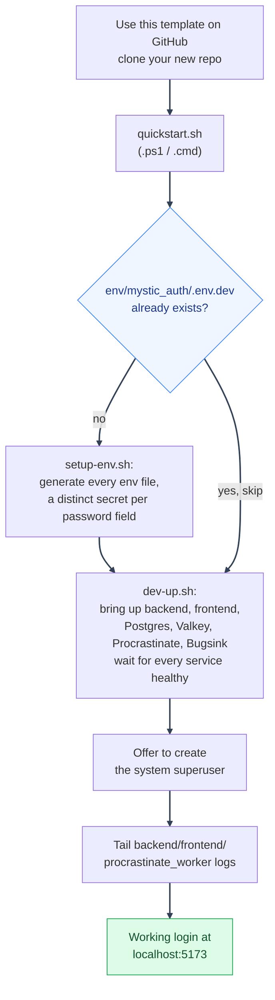

# Quickstart

---

*Part of [Using This Repository as a Template](overview.md). This page covers everything needed to go from a fresh clone to a running login with real credentials: the one-command path, each step run by hand, keeping env files honest over time, and the two things (OAuth, email) that need real values.*

## Quickstart

Prefer to hand this to an AI coding agent (Claude Code, Codex, or similar) instead of following the steps below yourself? See [`agent-prompts/new-project-setup.md`](../../../agent-prompts/mystic_auth/new-project-setup.md) at the repo root for a ready-to-paste prompt.



Every step above is safe to re-run: already-done work is skipped or made a no-op, not repeated.

1. Click **[Use this template](https://github.com/Nachiket-2024/mystic-auth/generate)**, then clone *your* new repo.
2. Run `./scripts/mystic_auth/env-tools/quickstart/quickstart.sh` (`.ps1` for PowerShell, `.cmd` for Command Prompt).

   This is the fastest path from a fresh clone to a working login: it runs `setup-env` for you if `env/mystic_auth/.env.dev` doesn't exist yet, brings the dev stack up and waits for every service to become healthy, offers to create the system superuser right there, then tails `backend`/`frontend`/`procrastinate_worker` logs the same way `dev-up` normally does. Safe to re-run any time - each step is skipped or made a no-op once it's already done.

   The first `dev-up` can take several minutes. Docker may need to download the
   `postgres:15`, `valkey/valkey:9.1.2-alpine`, and `bugsink/bugsink:2` images, build the local
   backend/worker/frontend images, initialize fresh named volumes, and run the
   migrations and Bugsink seed job. The duration depends on Docker Hub and
   Docker Desktop network speed. Subsequent starts normally reuse the pulled
   images and volumes and are much faster. A slow pull is not itself a service
   failure; look for an explicit registry error, a container in `Exited` or
   `Restarting` state, or the helper's timeout message.

Prefer to see and run each step yourself instead of one script doing all of it? That's exactly what `quickstart` runs under the hood:

- **Env setup**: `./scripts/mystic_auth/env-tools/setup-env/setup-env.sh` (`.ps1`/`.cmd`). Creates every `env/mystic_auth/.env*` and `env/app/.env*` file, plus `frontend/.env`, from its `.example`, asks once for an app name and brand color and applies both everywhere, and generates a distinct random secret for every password field, so this just works for local dev as-is. It skips any file that already exists, so it's safe to re-run. Only two things need real values before those specific features work: `GOOGLE_CLIENT_ID`/`GOOGLE_CLIENT_SECRET` ([OAuth setup](#oauth-setup-google)) and `FROM_EMAIL`/`GMAIL_APP_PASSWORD` ([Email setup](#email-setup)). Everything else runs fine without them. Prefer to do it by hand instead? Copy both `env/mystic_auth/.env.dev.example` to `env/mystic_auth/.env.dev` and `env/app/.env.dev.example` to `env/app/.env.dev`.
- **Bring the stack up**: `./scripts/mystic_auth/docker/dev/dev-up.sh` (`.ps1`/`.cmd`). Brings up backend, frontend, Postgres, Valkey, Procrastinate, and Bugsink, migrations included, then settles into showing just `backend`/`frontend`/`procrastinate_worker` logs instead of every service's full startup output (see [Docker Overview](../docker/dev-workflow.md#day-to-day-dev-up-helpers)). On a fresh machine, allow time for image pulls and local image builds; later starts are normally much faster. Plain `docker compose up` still works if you want everything's logs interleaved instead.
- **Create the system superuser** (one-time, CLI-only):

  ```bash
  docker compose -f docker/mystic_auth/compose/docker-compose.dev.yml -f docker/app/compose/docker-compose.dev.yml --env-file env/mystic_auth/.env.dev --env-file env/app/.env.dev exec -it backend python -m mystic_auth.scripts.create_system_user
  ```

  See [System Superuser: Bootstrapping and Promotion](../authentication/system-superuser/README.md) for the prompts.

---

Once it's up:

- **Backend docs**: [http://localhost:8000/docs](http://localhost:8000/docs)
- **Frontend**: [http://localhost:5173](http://localhost:5173)
- **Bugsink** (error monitoring): [http://localhost:8010](http://localhost:8010)
- **Procrastinate** (email and account-lifecycle delivery, retries, and scheduled account purge, audit-log anonymization, session and refresh-claim cleanup, and lifecycle-outbox reconciliation, all in one process): no UI or port, it just runs. The dev helper includes `procrastinate_worker` in the live log tail. Use `docker compose logs -f procrastinate_worker` when you want only its logs. See [Background Email Delivery](../background-workers/procrastinate.md).
- Postgres/Valkey default to `localhost:5433`/`localhost:6380` (non-default host ports, to avoid clashing with anything else you have running locally). If either port is already in use, change `POSTGRES_HOST_PORT` or `VALKEY_HOST_PORT` in `env/mystic_auth/.env.dev`; the paired Compose files and host-run backend tests use that multi-project port configuration.

---

## Keeping an env file honest over time

Three more scripts complement `setup-env`, once a file is no longer freshly generated:

- **`scripts/mystic_auth/env-tools/set-env-field/set-env-field.sh`** (`.ps1`/`.cmd`): sets one or more upstream-owned fields in every env file that already declares each key, for values meant to be the same everywhere (a contact address, OAuth credentials, or a shared rate limit) instead of opening and editing five files by hand. Easiest way: copy `shared-values.env.example` (next to the script) to `shared-values.env`, fill in whichever fields you want with a normal text editor, and run the script with no arguments. `set-env-field.sh SUPPORT_EMAIL=you@example.com GOOGLE_CLIENT_ID=...` also works directly, for scripting or an agent prompt. App-owned fields such as `DEFAULT_APP_POLICIES` belong in `scripts/app/env-tools/set-env-field/shared-values.env.example` and the paired `env/app/.env.<mode>` files, without touching upstream's split.

- **`scripts/mystic_auth/env-tools/check-env/check-env.sh`** (`.ps1`/`.cmd`): run this before starting local-prod or prod. It fails if `ENVIRONMENT=production` but a secret still equals the shipped placeholder, and fails early when production backup encryption or upload configuration is incomplete; `BACKUP_UPLOAD_COMMAND` must reference `$DUMP_FILE` so the generated dump and its `.hmac` sidecar are sent off-host. It warns on remaining `<your_...>` placeholders or a host port already bound by something else. It never writes anything.
- **`scripts/mystic_auth/env-tools/rotate-secrets/rotate-secrets.sh`** (`.ps1`/`.cmd`): regenerates `SECRET_KEY` and/or `BUGSINK_SECRET_KEY` in an existing env file. It's deliberately scoped to just those two: `POSTGRES_PASSWORD`, `APP_DB_PASSWORD`, `BUGSINK_SUPERUSER_PASSWORD`, and `VALKEY_PASSWORD` are backed by state a live service already has (a running Postgres only applies `POSTGRES_PASSWORD` on first volume init), so editing the file alone would just break the connection instead of rotating anything. Rotating those safely means changing them at the live service first (`ALTER ROLE ...`, Bugsink's own admin tools), not something either script attempts. Your own `env/app/` secret field, safe to rotate by editing the file? List it in `scripts/app/env-tools/rotate-secrets/fields.env.example`'s copy and this script picks it up too.

---

## Environment configuration

The paired [`env/mystic_auth/.env.dev.example`](../../../env/mystic_auth/.env.dev.example) and [`env/app/.env.dev.example`](../../../env/app/.env.dev.example) files are the source of truth for which values dev ships with and where they live; comments there are kept short and point at the full field-by-field reference instead of repeating it: [Environment Configuration](../environment/README.md) (split across [Backend Settings](../environment/backend.md), [Frontend Build Settings](../environment/frontend.md), and [Compose-Only Settings](../environment/compose.md)). `frontend/.env.example` only matters if you run the frontend locally with `npm run dev` instead of Docker.

To rename the app: set `APP_NAME` in `env/mystic_auth/.env.dev`, then rebuild with the normal paired Compose command or `dev-up` helper. `docker-compose.dev.yml` aliases `VITE_APP_NAME` from that same `APP_NAME` (the frontend value is baked in at build time), so there's only one setting to change, not two. Nothing else hardcodes a product name. CI keeps using its own placeholder `APP_NAME` regardless; that's expected, not something to sync.

To change the default brand color: set `BRAND_COLOR` in `env/mystic_auth/.env.dev` the same way, aliased to `VITE_BRAND_COLOR`. See [Appearance: Per-User Brand Color](../appearance/overview.md#default-brand-color).

Both `APP_NAME` and `BRAND_COLOR` need to be set again in whichever other
mode-specific template-derived files you actually use (`env/mystic_auth/.env.prod`,
`env/mystic_auth/.env.local-prod-cloudflare`, etc.) - each mode reads its own separate
env file, so the value you set in `env/mystic_auth/.env.dev` only affects the dev stack.
`scripts/mystic_auth/env-tools/setup-env/setup-env.sh` (see [Quickstart](#quickstart) above)
applies the same value to every file it creates in one pass, so this only
matters if you set these by hand instead.

If you'll ever run this fork on the same machine as another mystic-auth
fork (another "Use this template" project, yours or someone else's), also
set `COMPOSE_PROJECT_NAME`, the `*_HOST_PORT` vars, and `DOCKER_SUBNET`/the
`*_STATIC_IP` vars in `env/mystic_auth/.env.dev` (and in whichever other `env/mystic_auth/.env.*` files
you use) to something unique to this fork - every fork otherwise defaults
to the exact same Compose project name, host ports, and Docker network
subnet, and the two collide. The built frontend image name derives
from `COMPOSE_PROJECT_NAME` automatically, and the Bugsink team/project
label derives from `APP_NAME` automatically - neither needs a separate
setting. See
[Docker: Compose Modes](../docker/compose-modes.md#two-forks-of-this-template-collide-with-each-other-too).

---

## OAuth setup (Google)

For local development, create an External OAuth app in Testing status and add
your Google account as a test user. For a deployed application, complete the
consent-screen and publishing steps in the [downstream launch
checklist](downstream-launch-checklist.md#google-oauth-setup-testing-and-verification).
The application currently requests only `openid email profile`, Google's basic
identity scopes, rather than Gmail or other Google data.

1. Create an OAuth 2.0 Client ID in the [Google Cloud Console](https://console.cloud.google.com/apis/credentials) (Web application type).
2. Add an authorized redirect URI matching `GOOGLE_REDIRECT_URI` exactly (scheme, host, path, trailing slash all matter).
3. Fill in `env/mystic_auth/.env.dev`: `GOOGLE_CLIENT_ID`, `GOOGLE_CLIENT_SECRET`, `GOOGLE_REDIRECT_URI` (e.g. `http://localhost:8000/auth/oauth2/callback/google` locally).
4. For production, use the production hostname and HTTPS callback. Do not put
   `GOOGLE_CLIENT_SECRET` in frontend code or commit it.

See [OAuth2 / PKCE](../authentication/oauth2-pkce.md) for the mechanics and troubleshooting.

---

## Email setup

| Variable | Purpose |
|---|---|
| `FROM_EMAIL` | The Gmail account sending mail (also the SMTP username) |
| `GMAIL_APP_PASSWORD` | A Gmail [App Password](https://myaccount.google.com/apppasswords) (needs 2FA enabled) |
| `SUPPORT_EMAIL` | Optional `Reply-To`, falls back to `FROM_EMAIL` |

Without these, signup/verification/reset emails fail to send after retries, but the rest of the app keeps working. See [Background Email Delivery](../background-workers/procrastinate.md).

---

See [Using This Repository as a Template](overview.md) for the rest: what this template provides, the ownership split, customizing the frontend/backend, deployment, and staying in sync with upstream.

---
